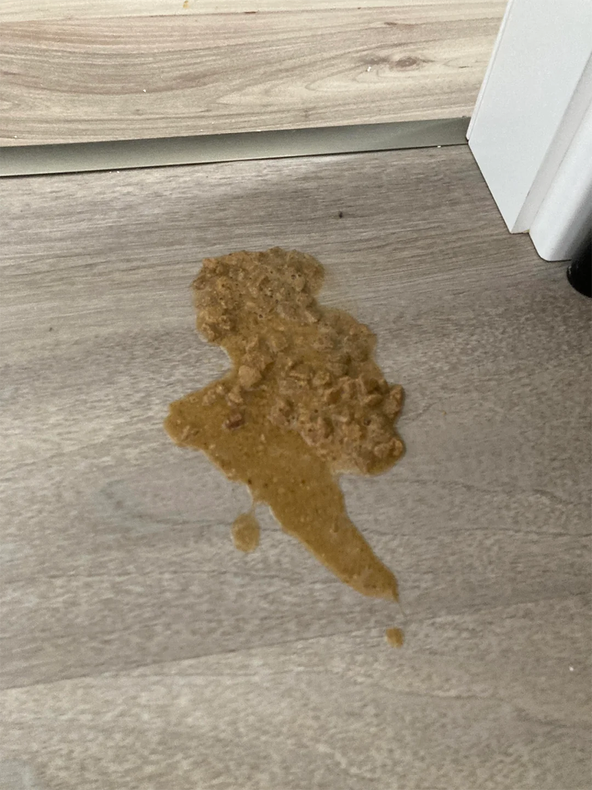

# 001 · Anna Rodriguez

- **Anuncio original:** [Meta · 1251516979953264](https://www.facebook.com/ads/library/?id=1251516979953264)
- **Página anunciante:** Anna Rodriguez · 1064783263379028
- **Destino observado:** [kittysupps.com](https://kittysupps.com/products/taurine)
- **Categoría:** Mascotas
- **Inicio publicado:** 2026-03-30 · 185 días de antigüedad.
- **Activo al consultar:** 2026-10-01T14:12:05.912606+00:00.
- **Ads activos globales de esa página:** aprox. 990 · [fuente](https://www.facebook.com/ads/library/?active_status=active&ad_type=all&country=ALL&media_type=all&search_type=page&view_all_page_id=1064783263379028).
- **Consulta geográfica:** [Estados Unidos](https://www.facebook.com/ads/library/?active_status=active&ad_type=all&country=US&media_type=image&q=I+thought&search_type=keyword_unordered).
- **Longitud del texto original:** 4295 palabras; el resumen de abajo es propio.

## Apertura breve del anuncio

> Switching to a different brand of pate

## Qué desarrolla el copy

El relato publicitario describe intentos fallidos de cambiar la comida de un gato, una pérdida emocional y una recomendación de una figura presentada como experta que conduce a KittySupps. Usa explicación de una supuesta causa oculta, comparación con otras soluciones, cronología de resultados y cierre de urgencia. Las afirmaciones veterinarias y los testimonios del anuncio no quedan validados por esta revisión.

## Qué muestra la imagen

Foto vertical doméstica de vómito o comida regurgitada sobre suelo de madera clara, junto a un zócalo.

## Por qué encaja en el formato nativo

Un detalle crudo del problema, sin marca ni sobreimpresiones, parece una consulta o advertencia publicada por una persona.

## Cómo adaptar la idea

Mostrar un problema cotidiano real y explicar el proceso de búsqueda de una solución con evidencia verificable. No reutilizar el relato de muerte, acusaciones ni promesas veterinarias como hechos.

## Alcance de la verificación

Actividad, fecha publicada, consulta US, conteo de la página y formato revisados. No se verificó entrega continua, rentabilidad, autoría del testimonio ni los resultados que anuncia. El dominio de destino no demuestra propiedad de la página. 
