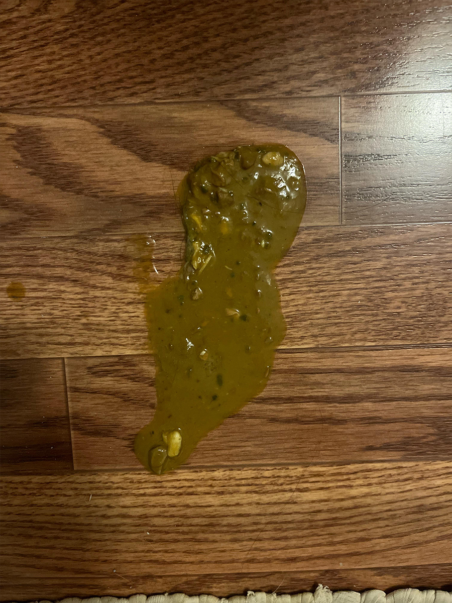

# 027 · Anna Rodriguez

- **Anuncio original:** [Meta · 1489223985754672](https://www.facebook.com/ads/library/?id=1489223985754672)
- **Página anunciante:** Anna Rodriguez · 1064783263379028
- **Destino observado:** [kittysupps.com](https://kittysupps.com/products/taurine)
- **Categoría:** Mascotas
- **Inicio publicado:** 2026-05-15 · 139 días de antigüedad.
- **Activo al consultar:** 2026-10-01T14:12:05.912606+00:00.
- **Ads activos globales de esa página:** aprox. 990 · [fuente](https://www.facebook.com/ads/library/?active_status=active&ad_type=all&country=ALL&media_type=all&search_type=page&view_all_page_id=1064783263379028).
- **Consulta geográfica:** [Estados Unidos](https://www.facebook.com/ads/library/?active_status=active&ad_type=all&country=US&media_type=image&q=I+thought&search_type=keyword_unordered).
- **Longitud del texto original:** 3414 palabras; el resumen de abajo es propio.

## Apertura breve del anuncio

> Switching to a different brand of pate

## Qué desarrolla el copy

El relato publicitario describe intentos fallidos de cambiar la comida de un gato, una pérdida emocional y una recomendación de una figura presentada como experta que conduce a KittySupps. Usa explicación de una supuesta causa oculta, comparación con otras soluciones, cronología de resultados y cierre de urgencia. Las afirmaciones veterinarias y los testimonios del anuncio no quedan validados por esta revisión.

## Qué muestra la imagen

Primer plano doméstico de una sustancia verde sobre parquet oscuro, sin texto ni branding.

## Por qué encaja en el formato nativo

Es una imagen del síntoma cotidiano que puede aparecer en un grupo de dueños de mascotas; el argumento comercial está en el copy largo.

## Cómo adaptar la idea

Usar una fotografía propia de la fricción cotidiana y un relato de resolución verificable; conservar la distancia entre experiencia individual y evidencia de eficacia.

## Alcance de la verificación

Actividad, fecha publicada, consulta US, conteo de la página y formato revisados. No se verificó entrega continua, rentabilidad, autoría del testimonio ni los resultados que anuncia. El dominio de destino no demuestra propiedad de la página. 
