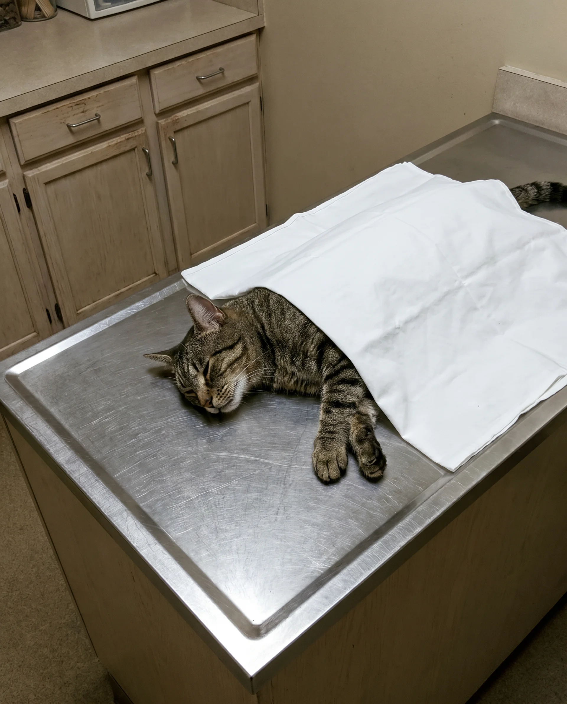

# 038 · Anna Rodriguez

- **Anuncio original:** [Meta · 1352719296852456](https://www.facebook.com/ads/library/?id=1352719296852456)
- **Página anunciante:** Anna Rodriguez · 1064783263379028
- **Destino observado:** [kittysupps.com](https://kittysupps.com/products/taurine)
- **Categoría:** Mascotas
- **Inicio publicado:** 2026-06-30 · 93 días de antigüedad.
- **Activo al consultar:** 2026-10-01T14:12:05.912606+00:00.
- **Ads activos globales de esa página:** aprox. 990 · [fuente](https://www.facebook.com/ads/library/?active_status=active&ad_type=all&country=ALL&media_type=all&search_type=page&view_all_page_id=1064783263379028).
- **Consulta geográfica:** [Estados Unidos](https://www.facebook.com/ads/library/?active_status=active&ad_type=all&country=US&media_type=image&q=I+thought&search_type=keyword_unordered).
- **Longitud del texto original:** 3675 palabras; el resumen de abajo es propio.

## Apertura breve del anuncio

> Switching to a different brand of pate

## Qué desarrolla el copy

Variante del relato de Anna con dos gatos adoptados: encadena intentos de alimentación, deterioro y pérdida, búsqueda de información y presentación de KittySupps mediante una persona del refugio. Conserva la estructura de descubrimiento de una supuesta causa oculta; las causas y resultados médicos son alegaciones del anunciante.

## Qué muestra la imagen

Foto de un gato sobre una mesa de exploración, parcialmente cubierto por una tela blanca; fondo de consulta veterinaria.

## Por qué encaja en el formato nativo

La imagen documental de una visita al veterinario sostiene el inicio emocional de una publicación larga y carece de elementos de banner.

## Cómo adaptar la idea

Adaptar la estructura problema → búsqueda → criterio de elección con una historia real autorizada. La imagen de contexto puede abrir el relato; no inventar autoridades, pérdidas ni resultados clínicos.

## Alcance de la verificación

Actividad, fecha publicada, consulta US, conteo de la página y formato revisados. No se verificó entrega continua, rentabilidad, autoría del testimonio ni los resultados que anuncia. El dominio de destino no demuestra propiedad de la página. 
