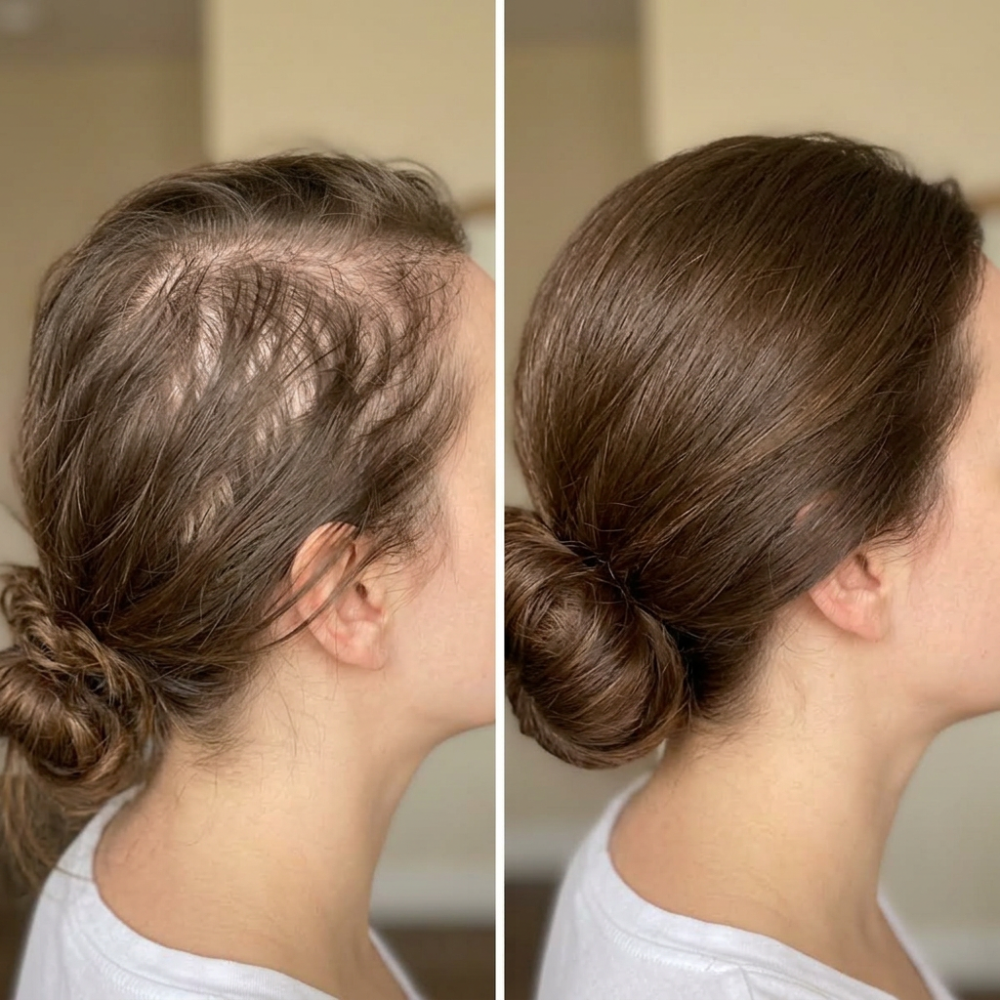

# 002 · Based Supplies

- **Anuncio original:** [Meta · 2029483551339198](https://www.facebook.com/ads/library/?id=2029483551339198)
- **Página anunciante:** Based Supplies · 161067203973094
- **Destino observado:** [www.basedsupplies.com](https://www.basedsupplies.com/pages/shampoo-1?utm_source=facebook&utm_medium=social&utm_campaign={{campaign.name}}&utm_term={{adset.name}}&utm_content={{ad.name}})
- **Categoría:** Cuidado personal
- **Inicio publicado:** 2026-04-18 · 166 días de antigüedad.
- **Activo al consultar:** 2026-10-01T14:12:05.912606+00:00.
- **Ads activos globales de esa página:** aprox. 1300 · [fuente](https://www.facebook.com/ads/library/?active_status=active&ad_type=all&country=ALL&media_type=all&search_type=page&view_all_page_id=161067203973094).
- **Consulta geográfica:** [Estados Unidos](https://www.facebook.com/ads/library/?active_status=active&ad_type=all&country=US&media_type=image&q=my+doctor&search_type=keyword_unordered).
- **Longitud del texto original:** 4520 palabras; el resumen de abajo es propio.

## Apertura breve del anuncio

> Please STOP buying hair growth supplements

## Qué desarrolla el copy

El copy cuenta gastos e intentos fallidos para recuperar densidad capilar y presenta la pregunta de una peluquera sobre el champú como giro narrativo. Atribuye el problema a los sulfatos y propone un champú con hidrosol de cebolla de Based Supplies; desarrolla objeciones de olor y espuma, una cronología de resultados y garantía. Son afirmaciones del anunciante, no eficacia médica verificada.

## Qué muestra la imagen

Dos fotografías del costado y la parte superior de la cabeza de una mujer con cabello recogido; la segunda muestra distinta densidad aparente.

## Por qué encaja en el formato nativo

La comparación utiliza fotos cercanas de una persona, sin diseño promocional, como registro testimonial de evolución. El copy coincide con el anuncio 1229755845899735, pero la fotografía es distinta.

## Cómo adaptar la idea

Explorar una prueba visual auténtica de un resultado cosmético, con autorización, fecha y condiciones comparables. Contar esta pieza como variante visual del mismo argumento, no como mecanismo nuevo.

## Alcance de la verificación

Actividad, fecha publicada, consulta US, conteo de la página y formato revisados. No se verificó entrega continua, rentabilidad, autoría del testimonio ni los resultados que anuncia. El dominio de destino no demuestra propiedad de la página. 
