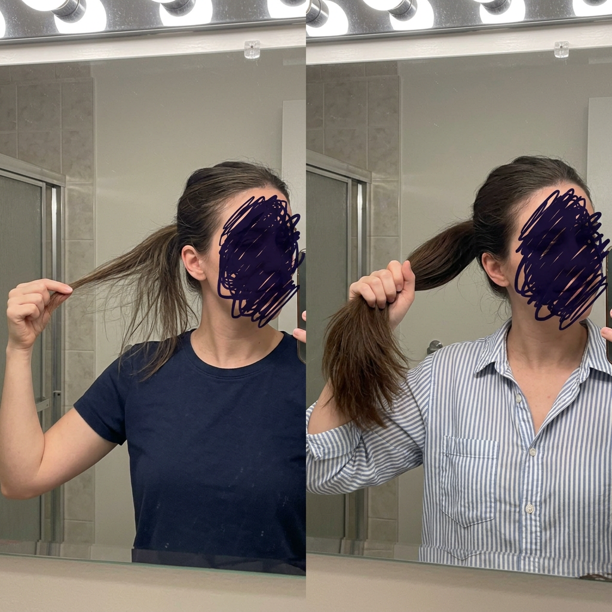

# 028 · Based Supplies

- **Anuncio original:** [Meta · 1229755845899735](https://www.facebook.com/ads/library/?id=1229755845899735)
- **Página anunciante:** Based Supplies · 161067203973094
- **Destino observado:** [www.basedsupplies.com](https://www.basedsupplies.com/pages/shampoo-1?utm_source=facebook&utm_medium=social&utm_campaign={{campaign.name}}&utm_term={{adset.name}}&utm_content={{ad.name}})
- **Categoría:** Cuidado personal
- **Inicio publicado:** 2026-04-27 · 157 días de antigüedad.
- **Activo al consultar:** 2026-10-01T14:12:05.912606+00:00.
- **Ads activos globales de esa página:** aprox. 1300 · [fuente](https://www.facebook.com/ads/library/?active_status=active&ad_type=all&country=ALL&media_type=all&search_type=page&view_all_page_id=161067203973094).
- **Consulta geográfica:** [Estados Unidos](https://www.facebook.com/ads/library/?active_status=active&ad_type=all&country=US&media_type=image&q=I+thought&search_type=keyword_unordered).
- **Longitud del texto original:** 4520 palabras; el resumen de abajo es propio.

## Apertura breve del anuncio

> Please STOP buying hair growth supplements

## Qué desarrolla el copy

El copy cuenta gastos e intentos fallidos para recuperar densidad capilar y presenta la pregunta de una peluquera sobre el champú como giro narrativo. Atribuye el problema a los sulfatos y propone un champú con hidrosol de cebolla de Based Supplies; desarrolla objeciones de olor y espuma, una cronología de resultados y garantía. Son afirmaciones del anunciante, no eficacia médica verificada.

## Qué muestra la imagen

Dos selfies de baño lado a lado: una mujer sujeta su cabello, con el rostro tachado y ropa distinta en cada mitad.

## Por qué encaja en el formato nativo

El collage de fotos de baño y el rostro tapado imitan una actualización personal de resultados, sin precio ni CTA en la imagen.

## Cómo adaptar la idea

Usar un caso real autorizado y fotos comparables con condiciones y fechas explícitas; desarrollar la objeción central de la categoría sin reproducir causalidades médicas no demostradas.

## Alcance de la verificación

Actividad, fecha publicada, consulta US, conteo de la página y formato revisados. No se verificó entrega continua, rentabilidad, autoría del testimonio ni los resultados que anuncia. El dominio de destino no demuestra propiedad de la página. 
