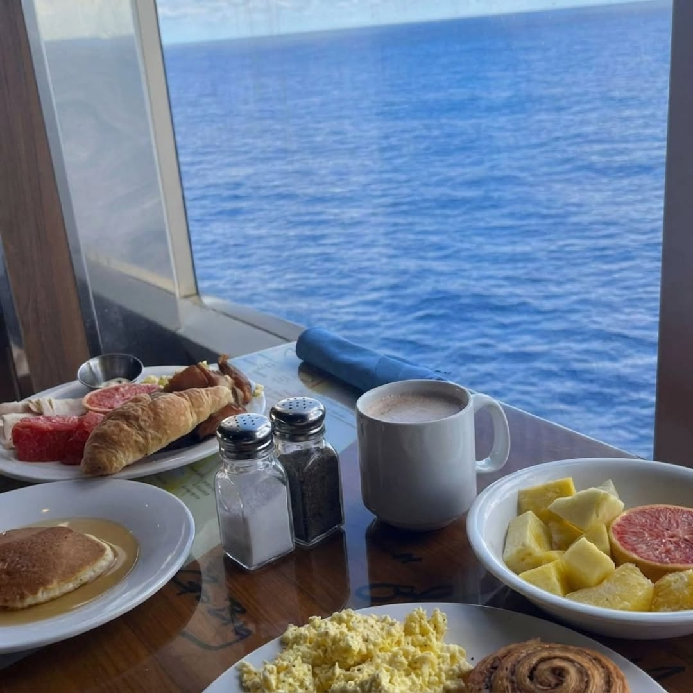

# 003 · Caroline Moore

- **Anuncio original:** [Meta · 1071518855411027](https://www.facebook.com/ads/library/?id=1071518855411027)
- **Página anunciante:** Caroline Moore · 1013442788524883
- **Destino observado:** [metabolae.com](https://metabolae.com/pages/lp-ceylon-cinnamon-insulin-1)
- **Categoría:** Bienestar y suplementos
- **Inicio publicado:** 2026-08-11 · 51 días de antigüedad.
- **Activo al consultar:** 2026-10-01T14:12:05.912606+00:00.
- **Ads activos globales de esa página:** aprox. 450 · [fuente](https://www.facebook.com/ads/library/?active_status=active&ad_type=all&country=ALL&is_targeted_country=false&media_type=all&search_type=page&view_all_page_id=1013442788524883).
- **Consulta geográfica:** [Estados Unidos](https://www.facebook.com/ads/library/?active_status=active&ad_type=all&country=US&media_type=image&q=my+doctor&search_type=keyword_unordered).
- **Longitud del texto original:** 4329 palabras; el resumen de abajo es propio.

## Apertura breve del anuncio

> I almost had a heart attack on a Caribbean cruise. The ship's doctor was from

## Qué desarrolla el copy

La narradora sitúa un susto de salud durante un crucero, introduce a una supuesta médica extranjera y desarrolla un descubrimiento que desemboca en Metabolae. Cierra con garantía, escasez y urgencia. Relato, autoridad y afirmaciones médicas no verificados.

## Qué muestra la imagen

Foto vertical de un desayuno sobre una mesa junto a una ventana con vista al mar; vajilla, comida y luz natural.

## Por qué encaja en el formato nativo

Escena personal de viaje sin marca, precio, CTA ni titular superpuesto.

## Cómo adaptar la idea

Usar una foto real del lugar donde comenzó una experiencia y abrir una historia concreta de descubrimiento. Sustituir las promesas médicas y el descrédito a tratamientos por beneficios y hechos comprobables.

## Alcance de la verificación

Actividad, fecha publicada, consulta US, conteo de la página y formato revisados. No se verificó entrega continua, rentabilidad, autoría del testimonio ni los resultados que anuncia. El dominio de destino no demuestra propiedad de la página. 
