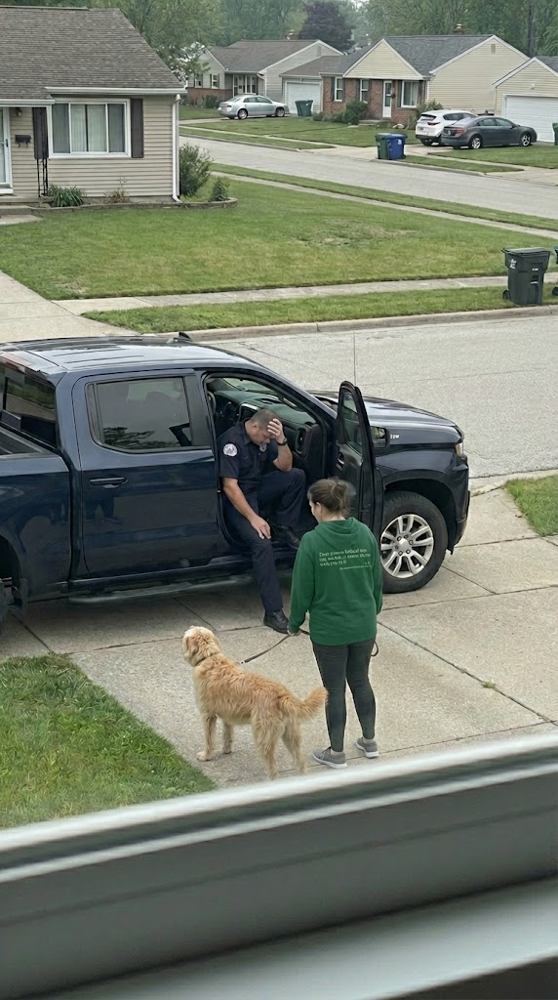

# 004 · DearPerson.Co

- **Anuncio original:** [Meta · 2382196885623396](https://www.facebook.com/ads/library/?id=2382196885623396)
- **Página anunciante:** DearPerson.Co · 516514524883699
- **Destino observado:** [dearpersonco.store](https://dearpersonco.store/products/the-dear-person-hoodie)
- **Categoría:** Moda y accesorios
- **Inicio publicado:** 2026-05-14 · 140 días de antigüedad.
- **Activo al consultar:** 2026-10-01T14:12:05.912606+00:00.
- **Ads activos globales de esa página:** aprox. 370 · [fuente](https://www.facebook.com/ads/library/?active_status=active&ad_type=all&country=ALL&is_targeted_country=false&media_type=all&search_type=page&view_all_page_id=516514524883699).
- **Consulta geográfica:** [Estados Unidos](https://www.facebook.com/ads/library/?active_status=active&ad_type=all&country=US&media_type=image&q=my+wife&search_type=keyword_unordered).
- **Longitud del texto original:** 570 palabras; el resumen de abajo es propio.

## Apertura breve del anuncio

> I've lived on this street in Plano for four years. I know which house has

## Qué desarrolla el copy

Historia de vecinos distantes que conectan a través del mensaje de una sudadera DearPersonCo. Presenta una conversación emocional, un supuesto origen de la marca y una comunidad como resultado, y termina con enlace. No se verificaron historia ni donaciones.

## Qué muestra la imagen

Foto tomada desde una ventana hacia una entrada de casa: una persona con prenda verde, un perro, una camioneta oscura y viviendas al fondo.

## Por qué encaja en el formato nativo

Encuadre casual de vecindario; no hay composición de banner ni elementos comerciales añadidos.

## Cómo adaptar la idea

Mostrar una interacción real en el contexto donde se usa el producto y contar qué conversación o acción concreta facilitó. Verificar cualquier testimonio, historia fundacional o donación mencionada.

## Alcance de la verificación

Actividad, fecha publicada, consulta US, conteo de la página y formato revisados. No se verificó entrega continua, rentabilidad, autoría del testimonio ni los resultados que anuncia. El dominio de destino no demuestra propiedad de la página. 
