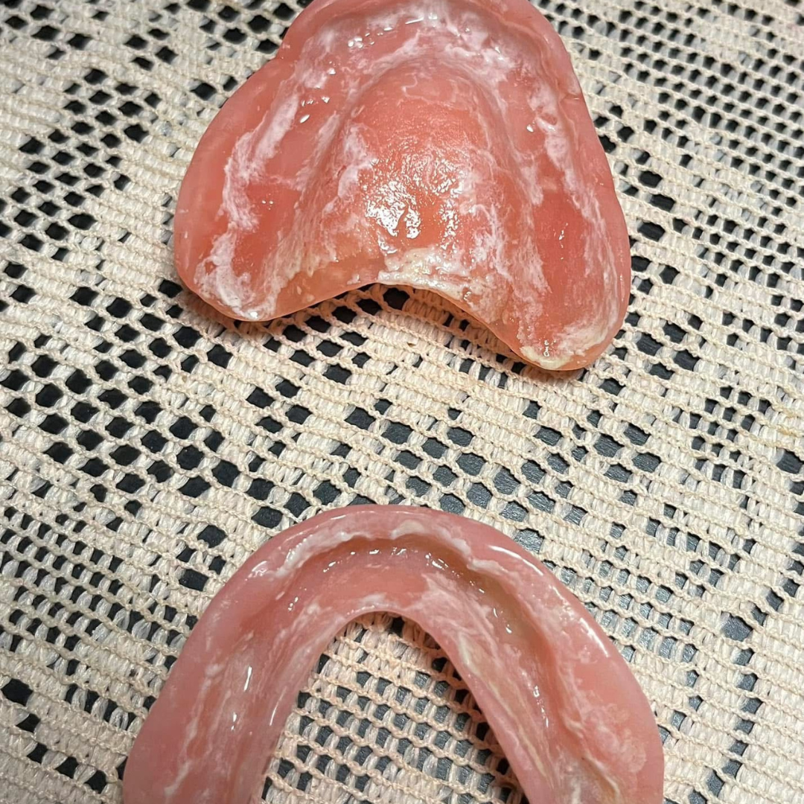

# 005 · Denture Care Tips

- **Anuncio original:** [Meta · 1320113750329087](https://www.facebook.com/ads/library/?id=1320113750329087)
- **Página anunciante:** Denture Care Tips · 783471631514555
- **Destino observado:** [ploise.vercel.app](https://ploise.vercel.app/ilp10)
- **Categoría:** Descanso y cuidado
- **Inicio publicado:** 2026-06-06 · 117 días de antigüedad.
- **Activo al consultar:** 2026-10-01T14:12:05.912606+00:00.
- **Ads activos globales de esa página:** aprox. 260 · [fuente](https://www.facebook.com/ads/library/?active_status=active&ad_type=all&country=ALL&is_targeted_country=false&media_type=all&search_type=page&view_all_page_id=783471631514555).
- **Consulta geográfica:** [Estados Unidos](https://www.facebook.com/ads/library/?active_status=active&ad_type=all&country=US&media_type=image&q=my+doctor&search_type=keyword_unordered).
- **Longitud del texto original:** 2168 palabras; el resumen de abajo es propio.

## Apertura breve del anuncio

> My daughter told me to post this. I said no. Too personal. Too embarrassing. She

## Qué desarrolla el copy

Relato atribuido a un jubilado que vincula un episodio de salud con su rutina de higiene de prótesis, critica alternativas y presenta Denture Dome mediante especificaciones, reseñas y garantía. Causalidad médica, comparaciones y testimonios no verificados.

## Qué muestra la imagen

Primer plano de dos prótesis dentales rosadas sobre una tela estampada, sin elementos tipográficos superpuestos.

## Por qué encaja en el formato nativo

Foto de un objeto cotidiano de uso personal; puede acompañar una historia o consulta sin parecer una pieza gráfica de venta.

## Cómo adaptar la idea

Abrir con una foto auténtica del objeto que evidencia una necesidad de mantenimiento y explicar un procedimiento comprobable. No copiar asociaciones entre higiene y episodios médicos sin sustento.

## Alcance de la verificación

Actividad, fecha publicada, consulta US, conteo de la página y formato revisados. No se verificó entrega continua, rentabilidad, autoría del testimonio ni los resultados que anuncia. El dominio de destino no demuestra propiedad de la página. 
