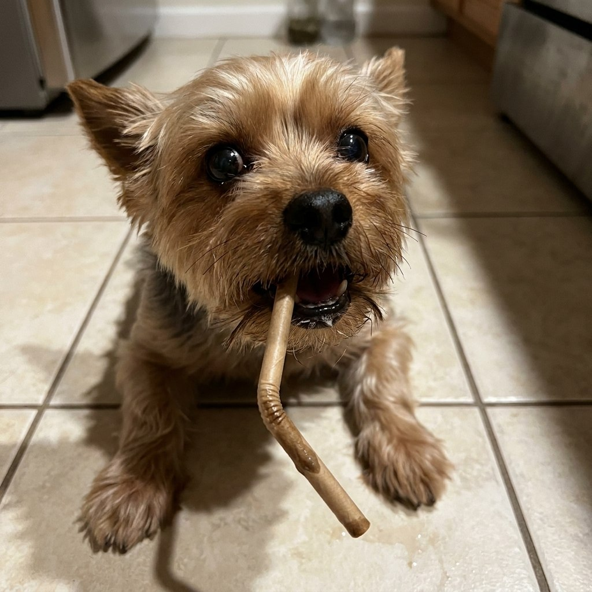

# 006 · Dog Owners Support Group

- **Anuncio original:** [Meta · 2167303190774271](https://www.facebook.com/ads/library/?id=2167303190774271)
- **Página anunciante:** Dog Owners Support Group · 866816573192726
- **Destino observado:** [weston-animal.co](https://weston-animal.co/products/airway)
- **Categoría:** Mascotas
- **Inicio publicado:** 2026-06-09 · 114 días de antigüedad.
- **Activo al consultar:** 2026-10-01T14:12:05.912606+00:00.
- **Ads activos globales de esa página:** aprox. 290 · [fuente](https://www.facebook.com/ads/library/?active_status=active&ad_type=all&country=ALL&media_type=all&search_type=page&view_all_page_id=866816573192726).
- **Consulta geográfica:** [Estados Unidos](https://www.facebook.com/ads/library/?active_status=active&ad_type=all&country=US&media_type=image&q=I+thought&search_type=keyword_unordered).
- **Longitud del texto original:** 2342 palabras; el resumen de abajo es propio.

## Apertura breve del anuncio

> I am going to lose it if one more person comments "oh that is just

## Qué desarrolla el copy

Abre con una intervención polémica sobre un ruido respiratorio, atribuye autoridad veterinaria a la narradora, compara suplementos y presenta AirWay. Enumera supuestos ensayos, cifras y fallas de competidores; esas afirmaciones no se verificaron.

## Qué muestra la imagen

Foto doméstica de un perro pequeño de pelo marrón sobre baldosas, con un objeto alargado en la boca; fondo de interior de casa.

## Por qué encaja en el formato nativo

Mascota en una escena cotidiana, sin precio, marca ni textos de oferta.

## Cómo adaptar la idea

Partir de una observación real del cuidado de una mascota y explicar una función demostrada del producto. Usar especialistas y estudios identificables; no trasladar diagnósticos ni acusaciones a competidores como hechos.

## Alcance de la verificación

Actividad, fecha publicada, consulta US, conteo de la página y formato revisados. No se verificó entrega continua, rentabilidad, autoría del testimonio ni los resultados que anuncia. El dominio de destino no demuestra propiedad de la página. 
