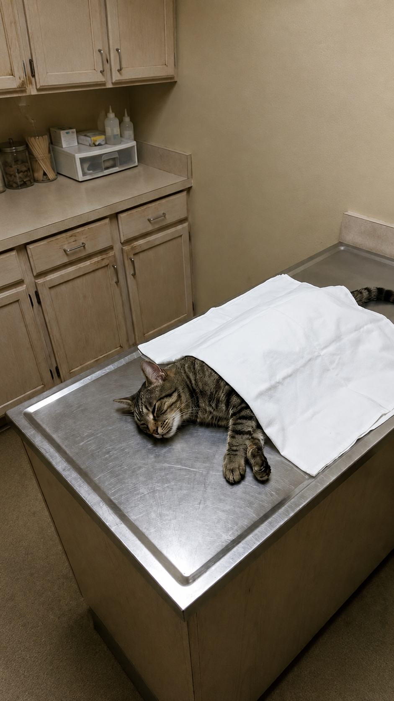

# 007 · Dr. Sarah Mitchell

- **Anuncio original:** [Meta · 4718249571742488](https://www.facebook.com/ads/library/?id=4718249571742488)
- **Página anunciante:** Dr. Sarah Mitchell · 774568199083884
- **Destino observado:** [selenepets.com](https://selenepets.com/products/the-kitty-fountain%E2%84%A2)
- **Categoría:** Mascotas
- **Inicio publicado:** 2026-08-25 · 37 días de antigüedad.
- **Activo al consultar:** 2026-10-01T14:12:05.912606+00:00.
- **Ads activos globales de esa página:** aprox. 600 · [fuente](https://www.facebook.com/ads/library/?active_status=active&ad_type=all&country=ALL&is_targeted_country=false&media_type=all&search_type=page&view_all_page_id=774568199083884).
- **Consulta geográfica:** [Estados Unidos](https://www.facebook.com/ads/library/?active_status=active&ad_type=all&country=US&media_type=image&q=my+doctor&search_type=keyword_unordered).
- **Longitud del texto original:** 2421 palabras; el resumen de abajo es propio.

## Apertura breve del anuncio

> Please STOP scrubbing your cat's water bowl. I know that sounds insane coming from a

## Qué desarrolla el copy

Gancho contraintuitivo sobre lavar el cuenco; relata la supuesta experiencia de una veterinaria, propone una explicación de biofilm y presenta una fuente Selene como solución. El relato y las afirmaciones sobre riñones, bacterias y exclusividad no se verificaron.

## Qué muestra la imagen

Foto vertical de un gato sobre una superficie de examen cubierta con papel blanco, en una habitación con muebles y equipo al fondo.

## Por qué encaja en el formato nativo

Aspecto documental de una escena de consulta; sin diseño de banner, título ni CTA sobre la imagen.

## Cómo adaptar la idea

Ilustrar un problema verificable de mantenimiento mediante una escena real y mostrar cómo el diseño del producto lo aborda. Evitar convertir una observación en una promesa de prevención o curación.

## Alcance de la verificación

Actividad, fecha publicada, consulta US, conteo de la página y formato revisados. No se verificó entrega continua, rentabilidad, autoría del testimonio ni los resultados que anuncia. El dominio de destino no demuestra propiedad de la página. 
