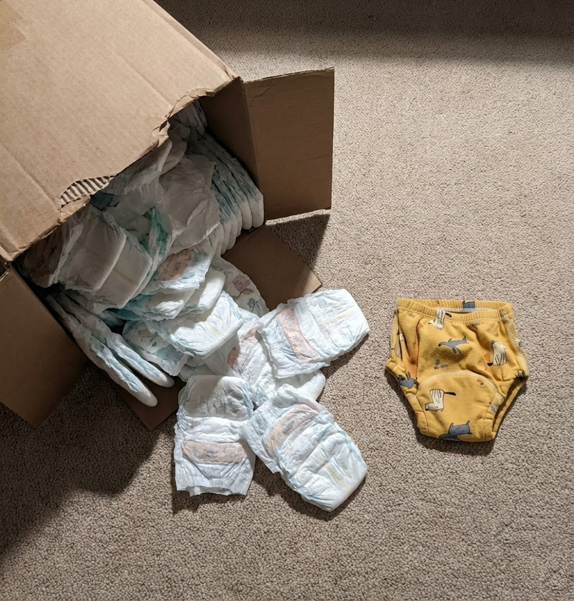

# 008 · Emma's Mom Hacks

- **Anuncio original:** [Meta · 1117879153560975](https://www.facebook.com/ads/library/?id=1117879153560975)
- **Página anunciante:** Emma's Mom Hacks · 681873181686696
- **Destino observado:** [www.upairy.com](https://www.upairy.com/pages/training-underwear)
- **Categoría:** Familia y crianza
- **Inicio publicado:** 2025-12-06 · 299 días de antigüedad.
- **Activo al consultar:** 2026-10-01T14:12:05.912606+00:00.
- **Ads activos globales de esa página:** aprox. 300 · [fuente](https://www.facebook.com/ads/library/?active_status=active&ad_type=all&country=ALL&is_targeted_country=false&media_type=all&search_type=page&view_all_page_id=681873181686696).
- **Consulta geográfica:** [Estados Unidos](https://www.facebook.com/ads/library/?active_status=active&ad_type=all&country=US&media_type=image&q=I+thought&search_type=keyword_unordered).
- **Longitud del texto original:** 874 palabras; el resumen de abajo es propio.

## Apertura breve del anuncio

> My son (26mo) potty trained in 3 days

## Qué desarrolla el copy

La narradora contrasta el largo aprendizaje de su hija con el de su hijo, introduce el problema de no percibir la humedad y presenta UpAiry como punto intermedio entre pañales y ropa interior. Detalla tres días, suma el caso de una familiar y cierra con un supuesto edit para compartir el enlace. Las duraciones narradas son alegaciones, no expectativas verificadas.

## Qué muestra la imagen

Caja abierta y pañales o ropa interior de entrenamiento repartidos sobre una alfombra, junto a una prenda amarilla infantil.

## Por qué encaja en el formato nativo

Foto doméstica sin producción de estudio ni texto superpuesto, coherente con una anécdota de crianza en el feed.

## Cómo adaptar la idea

Comparar dos formas reales de resolver una fricción cotidiana, mostrar el producto en su contexto de uso y explicar su función. Usar testimonios auténticos y evitar prometer plazos de desarrollo infantil.

## Alcance de la verificación

Actividad, fecha publicada, consulta US, conteo de la página y formato revisados. No se verificó entrega continua, rentabilidad, autoría del testimonio ni los resultados que anuncia. El dominio de destino no demuestra propiedad de la página. 
