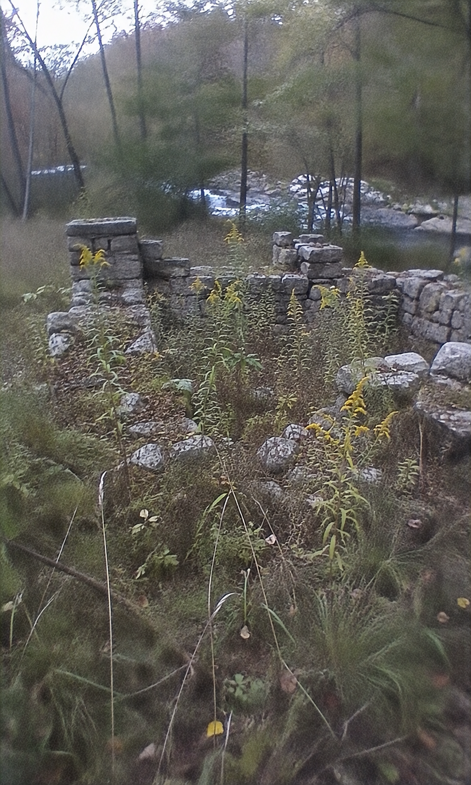

# 009 · Essential Health Finds

- **Anuncio original:** [Meta · 1371433571818814](https://www.facebook.com/ads/library/?id=1371433571818814)
- **Página anunciante:** Essential Health Finds · 218077708066307
- **Destino observado:** [track.tryrosabella.com](https://track.tryrosabella.com/8ae97cac-2146-42d6-af75-de0e59d15644)
- **Categoría:** Bienestar y suplementos
- **Inicio publicado:** 2026-08-25 · 37 días de antigüedad.
- **Activo al consultar:** 2026-10-01T14:12:05.912606+00:00.
- **Ads activos globales de esa página:** aprox. 460 · [fuente](https://www.facebook.com/ads/library/?active_status=active&ad_type=all&country=ALL&media_type=all&search_type=page&view_all_page_id=218077708066307).
- **Consulta geográfica:** [Estados Unidos](https://www.facebook.com/ads/library/?active_status=active&ad_type=all&country=US&media_type=image&q=my+doctor&search_type=keyword_unordered).
- **Longitud del texto original:** 2840 palabras; el resumen de abajo es propio.

## Apertura breve del anuncio

> Picture a Mill That Never Worked Late

## Qué desarrolla el copy

Una historia ilustrativa de Dot y un molino contrapone esfuerzos intensos con constancia cotidiana. Tras desarrollar esa metáfora, presenta Rosabella Beetroot como una forma sencilla de incorporar un hábito, detalla composición y garantía y aclara que no promete una transformación.

## Qué muestra la imagen

Fotografía de un pequeño cauce o canal entre vegetación y árboles, con construcciones o elementos del entorno rural.

## Por qué encaja en el formato nativo

La escena parece la ilustración de una crónica o reflexión; no muestra envase, precio ni botones comerciales.

## Cómo adaptar la idea

Construir una historia ilustrativa identificada como tal sobre constancia y mostrar un producto que simplifique un hábito. Mantener clara su naturaleza comercial y el alcance comprobable de sus beneficios.

## Alcance de la verificación

Actividad, fecha publicada, consulta US, conteo de la página y formato revisados. No se verificó entrega continua, rentabilidad, autoría del testimonio ni los resultados que anuncia. El dominio de destino no demuestra propiedad de la página. 
