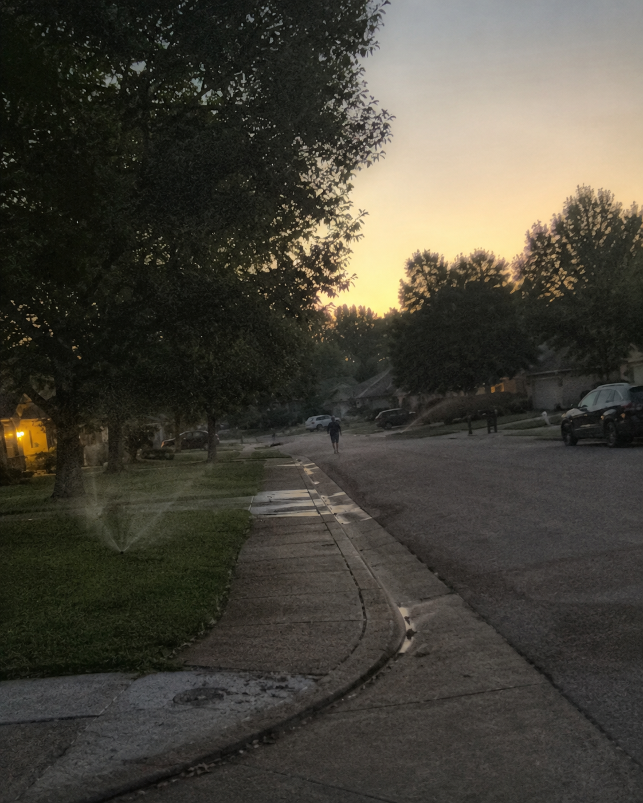

# 029 · Essential Health Finds

- **Anuncio original:** [Meta · 3658038091030785](https://www.facebook.com/ads/library/?id=3658038091030785)
- **Página anunciante:** Essential Health Finds · 218077708066307
- **Destino observado:** [track.tryrosabella.com](https://track.tryrosabella.com/cdc16426-3e48-40a7-9fad-21098084f6cf)
- **Categoría:** Bienestar y suplementos
- **Inicio publicado:** 2026-08-25 · 37 días de antigüedad.
- **Activo al consultar:** 2026-10-01T14:12:05.912606+00:00.
- **Ads activos globales de esa página:** aprox. 460 · [fuente](https://www.facebook.com/ads/library/?active_status=active&ad_type=all&country=ALL&media_type=all&search_type=page&view_all_page_id=218077708066307).
- **Consulta geográfica:** [Estados Unidos](https://www.facebook.com/ads/library/?active_status=active&ad_type=all&country=US&media_type=image&q=my+wife&search_type=keyword_unordered).
- **Longitud del texto original:** 2720 palabras; el resumen de abajo es propio.

## Apertura breve del anuncio

> She Hasn't Missed a Morning in Thirty-One Years.

## Qué desarrolla el copy

La historia de Ray y June presenta una caminata diaria sostenida durante años para explicar cómo agregar una acción pequeña a una rutina existente. Conecta esa idea con cápsulas Rosabella Beetroot junto al café, información de etiqueta, valoraciones declaradas y garantía.

## Qué muestra la imagen

Foto vertical de una calle residencial al amanecer o atardecer, con árboles, acera y vehículos al fondo.

## Por qué encaja en el formato nativo

La imagen de barrio acompaña una historia de vecinos como lo haría una columna humana, sin estética de catálogo.

## Cómo adaptar la idea

Explicar la conveniencia del producto mediante una rutina ya existente; si se usan personajes ilustrativos, declararlo y evitar convertirlos en falsos clientes satisfechos.

## Alcance de la verificación

Actividad, fecha publicada, consulta US, conteo de la página y formato revisados. No se verificó entrega continua, rentabilidad, autoría del testimonio ni los resultados que anuncia. El dominio de destino no demuestra propiedad de la página. 
