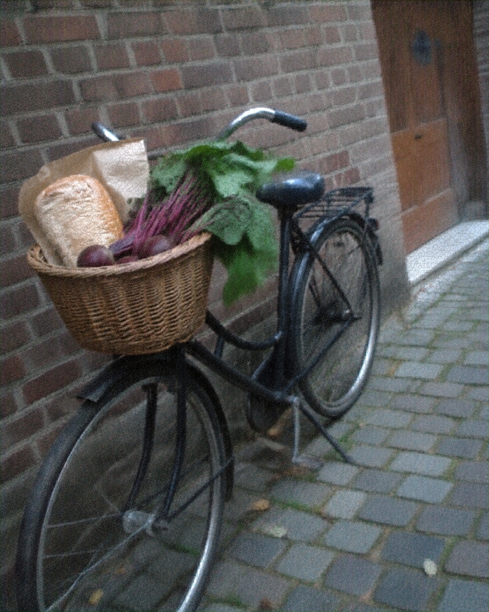

# 039 · Essential Health Finds

- **Anuncio original:** [Meta · 1394584578737597](https://www.facebook.com/ads/library/?id=1394584578737597)
- **Página anunciante:** Essential Health Finds · 218077708066307
- **Destino observado:** [track.tryrosabella.com](https://track.tryrosabella.com/8ae97cac-2146-42d6-af75-de0e59d15644)
- **Categoría:** Bienestar y suplementos
- **Inicio publicado:** 2026-08-25 · 37 días de antigüedad.
- **Activo al consultar:** 2026-10-01T14:12:05.912606+00:00.
- **Ads activos globales de esa página:** aprox. 460 · [fuente](https://www.facebook.com/ads/library/?active_status=active&ad_type=all&country=ALL&media_type=all&search_type=page&view_all_page_id=218077708066307).
- **Consulta geográfica:** [Estados Unidos](https://www.facebook.com/ads/library/?active_status=active&ad_type=all&country=US&media_type=image&q=my+wife&search_type=keyword_unordered).
- **Longitud del texto original:** 2418 palabras; el resumen de abajo es propio.

## Apertura breve del anuncio

> Picture a Town Where Every Bicycle Has a Basket

## Qué desarrolla el copy

El viaje de Judith a una ciudad donde las bicicletas sirven para hacer mandados introduce la idea de unir un hábito a una necesidad habitual. El copy conecta esa facilidad con Rosabella Beetroot en cápsulas y explicita que sus personajes son ilustrativos.

## Qué muestra la imagen

Bicicleta negra apoyada junto a una pared de ladrillos, con cesta de compras que incluye pan y verduras.

## Por qué encaja en el formato nativo

La foto funciona como recuerdo de paseo o ilustración de un ensayo sobre hábitos; no hay elementos gráficos de venta.

## Cómo adaptar la idea

Mostrar un objeto cotidiano que explique la conveniencia del producto por analogía. Desarrollar el valor de reducir pasos y tiempo con datos reales, sin simular noticias ni testimonios independientes.

## Alcance de la verificación

Actividad, fecha publicada, consulta US, conteo de la página y formato revisados. No se verificó entrega continua, rentabilidad, autoría del testimonio ni los resultados que anuncia. El dominio de destino no demuestra propiedad de la página. 
