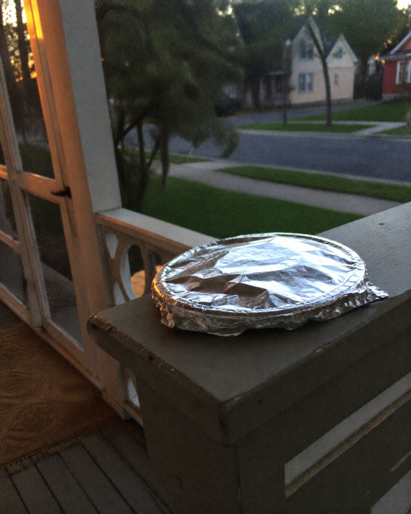

# 046 · Essential Health Finds

- **Anuncio original:** [Meta · 1077283944696419](https://www.facebook.com/ads/library/?id=1077283944696419)
- **Página anunciante:** Essential Health Finds · 218077708066307
- **Destino observado:** [track.tryrosabella.com](https://track.tryrosabella.com/cdc16426-3e48-40a7-9fad-21098084f6cf)
- **Categoría:** Bienestar y suplementos
- **Inicio publicado:** 2026-08-25 · 37 días de antigüedad.
- **Activo al consultar:** 2026-10-01T14:12:05.912606+00:00.
- **Ads activos globales de esa página:** aprox. 460 · [fuente](https://www.facebook.com/ads/library/?active_status=active&ad_type=all&country=ALL&media_type=all&search_type=page&view_all_page_id=218077708066307).
- **Consulta geográfica:** [Estados Unidos](https://www.facebook.com/ads/library/?active_status=active&ad_type=all&country=US&media_type=image&q=my+doctor&search_type=keyword_unordered).
- **Longitud del texto original:** 2133 palabras; el resumen de abajo es propio.

## Apertura breve del anuncio

> Every Sunday for Three Years, a Covered Plate

## Qué desarrolla el copy

Un plato que un vecino deja cada domingo da pie a una historia sobre generosidad y diferencias entre rutinas. El argumento presenta las cápsulas de Rosabella como un formato que cabe en una semana ocupada, en contraste con el tiempo que demanda preparar remolacha; aclara que no sustituye el plato ni promete transformaciones.

## Qué muestra la imagen

Plato cubierto con papel aluminio sobre una baranda de porche, con una calle residencial al fondo.

## Por qué encaja en el formato nativo

El objeto genera curiosidad y parece una foto tomada para contar una historia entre vecinos, sin mostrar el suplemento.

## Cómo adaptar la idea

Abrir con un objeto real que despierte curiosidad y revelar después su relación con la fricción que resuelve el producto. Conservar el beneficio de conveniencia y no fabricar una experiencia de cliente.

## Alcance de la verificación

Actividad, fecha publicada, consulta US, conteo de la página y formato revisados. No se verificó entrega continua, rentabilidad, autoría del testimonio ni los resultados que anuncia. El dominio de destino no demuestra propiedad de la página. 
