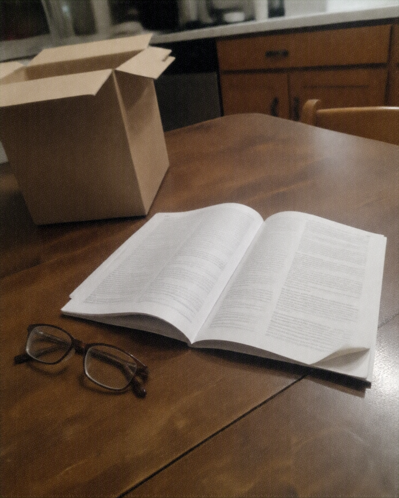

# 050 · Essential Health Finds

- **Anuncio original:** [Meta · 1592133112319199](https://www.facebook.com/ads/library/?id=1592133112319199)
- **Página anunciante:** Essential Health Finds · 218077708066307
- **Destino observado:** [track.tryrosabella.com](https://track.tryrosabella.com/8ae97cac-2146-42d6-af75-de0e59d15644)
- **Categoría:** Bienestar y suplementos
- **Inicio publicado:** 2026-08-25 · 37 días de antigüedad.
- **Activo al consultar:** 2026-10-01T14:12:05.912606+00:00.
- **Ads activos globales de esa página:** aprox. 460 · [fuente](https://www.facebook.com/ads/library/?active_status=active&ad_type=all&country=ALL&media_type=all&search_type=page&view_all_page_id=218077708066307).
- **Consulta geográfica:** [Estados Unidos](https://www.facebook.com/ads/library/?active_status=active&ad_type=all&country=US&media_type=image&q=my+doctor&search_type=keyword_unordered).
- **Longitud del texto original:** 1934 palabras; el resumen de abajo es propio.

## Apertura breve del anuncio

> Every Family Has One Person Who Actually Reads

## Qué desarrolla el copy

Irene, explícitamente presentada como personaje ilustrativo, representa al familiar que revisa la letra pequeña. El relato transforma el cansancio frente a etiquetas complejas en un argumento a favor de una fórmula simple de Rosabella Beetroot, con dosis declarada, rutina breve y garantía.

## Qué muestra la imagen

Libro o manual abierto sobre una mesa de madera, gafas de lectura al lado y caja de cartón al fondo.

## Por qué encaja en el formato nativo

Es una escena doméstica de lectura que acompaña un ensayo sobre consumo consciente, sin envase ni diseño de oferta.

## Cómo adaptar la idea

Hablar a quien compara antes de comprar y ofrecer una explicación verificable de ingredientes, materiales o condiciones. Usar una foto cotidiana de revisión y una narrativa comercial transparente.

## Alcance de la verificación

Actividad, fecha publicada, consulta US, conteo de la página y formato revisados. No se verificó entrega continua, rentabilidad, autoría del testimonio ni los resultados que anuncia. El dominio de destino no demuestra propiedad de la página. 
