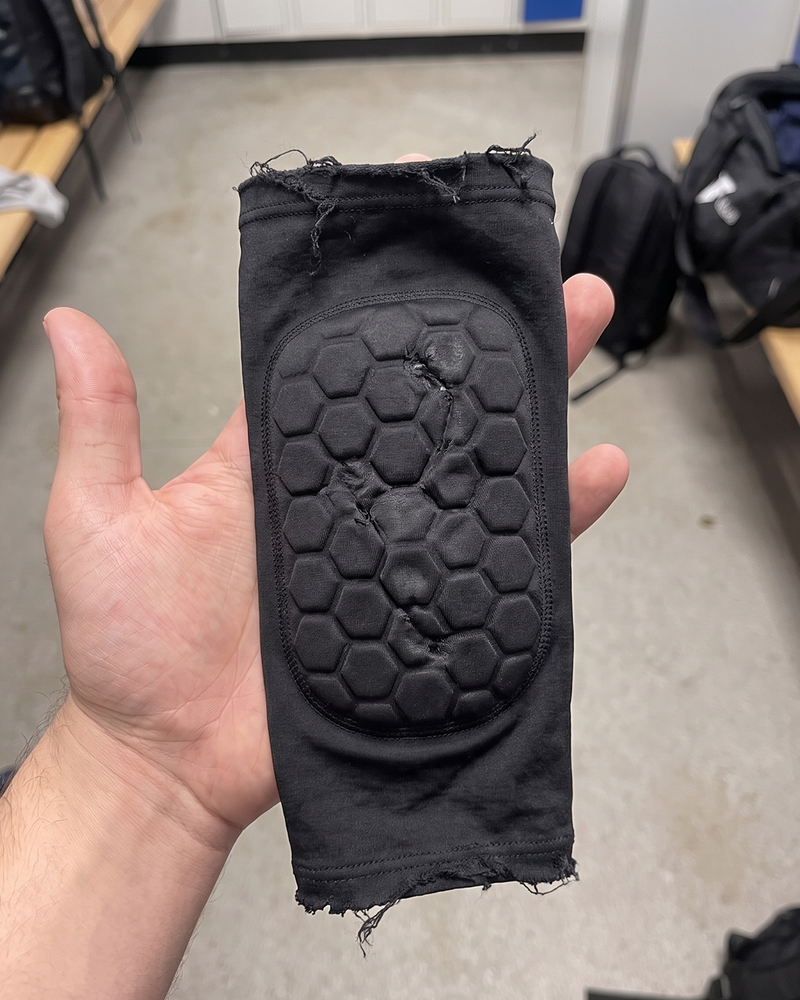

# 010 · FLAIR Fútbol

- **Anuncio original:** [Meta · 2246600785882765](https://www.facebook.com/ads/library/?id=2246600785882765)
- **Página anunciante:** FLAIR Fútbol · 270164032846804
- **Destino observado:** [www.flairfutbol.com](https://www.flairfutbol.com/collections/warehouse-sale)
- **Categoría:** Deporte
- **Inicio publicado:** 2026-08-09 · 53 días de antigüedad.
- **Activo al consultar:** 2026-10-01T14:12:05.912606+00:00.
- **Ads activos globales de esa página:** 1771 · [fuente](https://www.facebook.com/ads/library/?active_status=active&ad_type=all&country=ALL&media_type=all&search_type=page&view_all_page_id=270164032846804).
- **Consulta geográfica:** [Estados Unidos](https://www.facebook.com/ads/library/?active_status=active&ad_type=all&country=US&media_type=image&q=I+thought&search_type=keyword_unordered).
- **Longitud del texto original:** 471 palabras; el resumen de abajo es propio.

## Apertura breve del anuncio

> I bought these viral sleeve shin pads

## Qué desarrolla el copy

El relato describe la compra de una alternativa barata, problemas de entrega y deterioro, y la posterior elección de FLAIR. La narración compara construcción, ajuste, lavados y durabilidad, antes de mencionar la garantía.

## Qué muestra la imagen

Una mano sostiene una espinillera negra de manga; se ven asientos y objetos de un vestuario al fondo.

## Por qué encaja en el formato nativo

El encuadre informal de mano y vestuario parece una recomendación de un jugador, sin tipografía añadida ni oferta visual.

## Cómo adaptar la idea

Documentar el costo total de una alternativa de menor calidad y mostrar detalles reales de uso; sustentar comparaciones y duración con pruebas propias y testimonios autorizados.

## Alcance de la verificación

Actividad, fecha publicada, consulta US, conteo de la página y formato revisados. No se verificó entrega continua, rentabilidad, autoría del testimonio ni los resultados que anuncia. El dominio de destino no demuestra propiedad de la página. 
