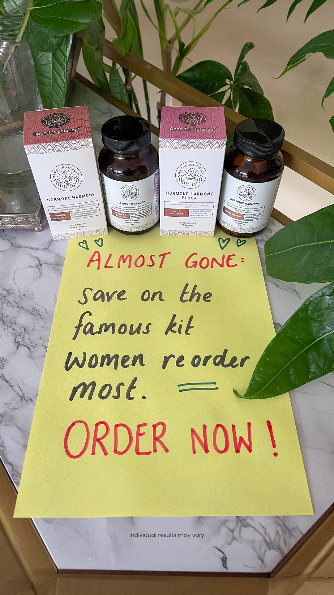

# 040 · Happy Mammoth

- **Anuncio original:** [Meta · 1079965504562673](https://www.facebook.com/ads/library/?id=1079965504562673)
- **Página anunciante:** Happy Mammoth · 1343771369029582
- **Destino observado:** [store.happymammoth.com](https://store.happymammoth.com/pages/hormone-reset-plan)
- **Categoría:** Bienestar y suplementos
- **Inicio publicado:** 2026-08-23 · 39 días de antigüedad.
- **Activo al consultar:** 2026-10-01T14:05:50.037657+00:00.
- **Ads activos globales de esa página:** 1174 · [fuente](https://www.facebook.com/ads/library/?active_status=active&ad_type=all&country=ALL&media_type=all&search_type=page&view_all_page_id=1343771369029582).
- **Consulta geográfica:** [Estados Unidos](https://www.facebook.com/ads/library/?active_status=active&ad_type=all&country=US&media_type=all&search_type=page&view_all_page_id=1343771369029582).
- **Longitud del texto original:** 242 palabras; el resumen de abajo es propio.

## Apertura breve del anuncio

> Feeling exhausted, wanting to cry, and punch everyone? That's cortisol. Poor sleep,

## Qué desarrolla el copy

El copy vincula molestias cotidianas a un supuesto desbalance hormonal, introduce un descubrimiento en primera persona, atribuye mejoras al producto y cierra con el kit. Son afirmaciones del anunciante, no verificadas aquí.

## Qué muestra la imagen

Frascos y cajas en una superficie tipo mármol junto a una planta; nota manuscrita amarilla de urgencia delante.

## Por qué encaja en el formato nativo

Foto cotidiana de productos sobre una superficie doméstica junto a una planta y una nota manuscrita; sin composición de banner. Aunque comparte copy y concepto con otro anuncio, la fotografía es distinta.

## Cómo adaptar la idea

Usar una escena real de uso doméstico y una nota genuina que introduzca la historia; mantener afirmaciones verificables y no recrear falsas experiencias personales.

## Alcance de la verificación

Actividad, fecha publicada, consulta US, conteo de la página y formato revisados. No se verificó entrega continua, rentabilidad, autoría del testimonio ni los resultados que anuncia. El dominio de destino no demuestra propiedad de la página. DCO: la antigüedad pertenece al registro; no se puede fechar cada combinación de imagen y copy.
