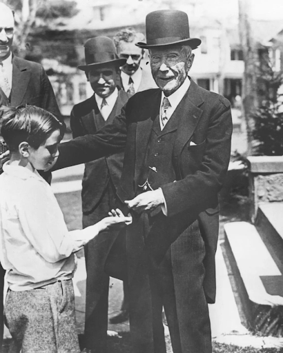

# 012 · Heart & Soil

- **Anuncio original:** [Meta · 1678247426600495](https://www.facebook.com/ads/library/?id=1678247426600495)
- **Página anunciante:** Heart & Soil · 105838504500661
- **Destino observado:** [shop.heartandsoil.co](https://shop.heartandsoil.co/products/beef-organs)
- **Categoría:** Bienestar y suplementos
- **Inicio publicado:** 2026-08-12 · 50 días de antigüedad.
- **Activo al consultar:** 2026-10-01T14:12:05.912606+00:00.
- **Ads activos globales de esa página:** aprox. 2400 · [fuente](https://www.facebook.com/ads/library/?active_status=active&ad_type=all&country=ALL&media_type=all&search_type=page&view_all_page_id=105838504500661).
- **Consulta geográfica:** [Estados Unidos](https://www.facebook.com/ads/library/?active_status=active&ad_type=all&country=US&media_type=image&q=my+doctor&search_type=keyword_unordered).
- **Longitud del texto original:** 1883 palabras; el resumen de abajo es propio.

## Apertura breve del anuncio

> In 1910, John D. Rockefeller and Andrew Carnegie

## Qué desarrolla el copy

El copy de Heart & Soil construye una narrativa histórica sobre el informe Flexner y una supuesta pérdida de la nutrición con órganos. Usa cronología, figuras públicas y citas de estudios como autoridad, luego introduce Beef Organs, testimonios y oferta de suscripción. Esta revisión identifica la técnica narrativa; no verifica ni avala sus acusaciones históricas o alegaciones sanitarias.

## Qué muestra la imagen

Fotografía histórica en blanco y negro de varios hombres con traje y sombrero, en una escena pública de saludo.

## Por qué encaja en el formato nativo

Imagen de archivo sin logotipo ni precio que sostiene la apariencia de un artículo histórico largo.

## Cómo adaptar la idea

Adaptar el formato de explicación histórica únicamente con fuentes comprobadas y conexión honesta con el producto. No reproducir acusaciones, conspiraciones ni promesas de sustituir tratamientos.

## Alcance de la verificación

Actividad, fecha publicada, consulta US, conteo de la página y formato revisados. No se verificó entrega continua, rentabilidad, autoría del testimonio ni los resultados que anuncia. El dominio de destino no demuestra propiedad de la página. 
