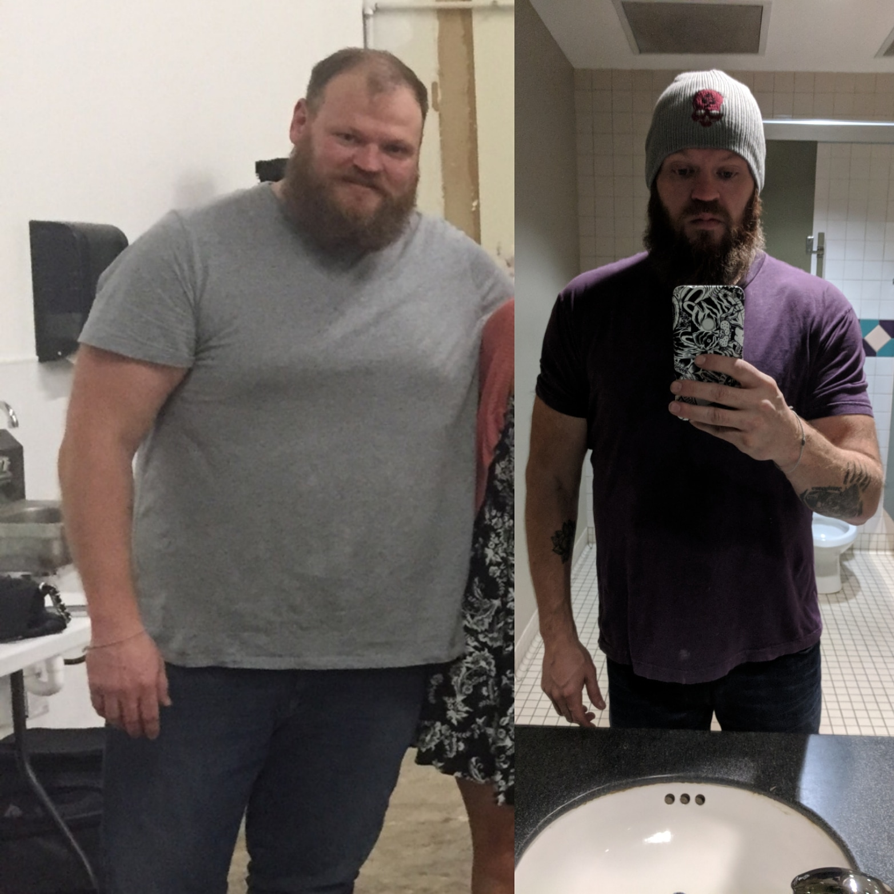

# 014 · Jacob Nash

- **Anuncio original:** [Meta · 1363618465225052](https://www.facebook.com/ads/library/?id=1363618465225052)
- **Página anunciante:** Jacob Nash · 995924326928689
- **Destino observado:** [spnutrition-us.com](https://spnutrition-us.com/pages/consumer-tested-men-listicle)
- **Categoría:** Bienestar y suplementos
- **Inicio publicado:** 2026-08-06 · 56 días de antigüedad.
- **Activo al consultar:** 2026-10-01T14:12:05.912606+00:00.
- **Ads activos globales de esa página:** aprox. 450 · [fuente](https://www.facebook.com/ads/library/?active_status=active&ad_type=all&country=ALL&is_targeted_country=false&media_type=all&search_type=page&view_all_page_id=995924326928689).
- **Consulta geográfica:** [Estados Unidos](https://www.facebook.com/ads/library/?active_status=active&ad_type=all&country=US&media_type=image&q=my+wife&search_type=keyword_unordered).
- **Longitud del texto original:** 3950 palabras; el resumen de abajo es propio.

## Apertura breve del anuncio

> I'm going to say something that nobody walking around with a f**king beer gut wants

## Qué desarrolla el copy

Texto confrontativo que cuestiona intentos de bajar peso, atribuye el problema a una explicación hormonal, narra un descubrimiento y vende un suplemento de SP Nutrition con resultados y urgencia. No se verificó la transformación ni las afirmaciones fisiológicas.

## Qué muestra la imagen

Dos fotografías yuxtapuestas de un hombre con diferente apariencia corporal: una toma de pie y una selfie en espejo de baño. Sin titulares ni precios.

## Por qué encaja en el formato nativo

Comparativa de aspecto personal con fotos de estilo doméstico; no emplea formato de banner comercial.

## Cómo adaptar la idea

Si existe una evolución real y documentada, presentarla con contexto, periodo y límites. Reutilizar la estructura objeción→experiencia→aprendizaje sin prometer cambios corporales ni falsificar antes/después.

## Alcance de la verificación

Actividad, fecha publicada, consulta US, conteo de la página y formato revisados. No se verificó entrega continua, rentabilidad, autoría del testimonio ni los resultados que anuncia. El dominio de destino no demuestra propiedad de la página. 
