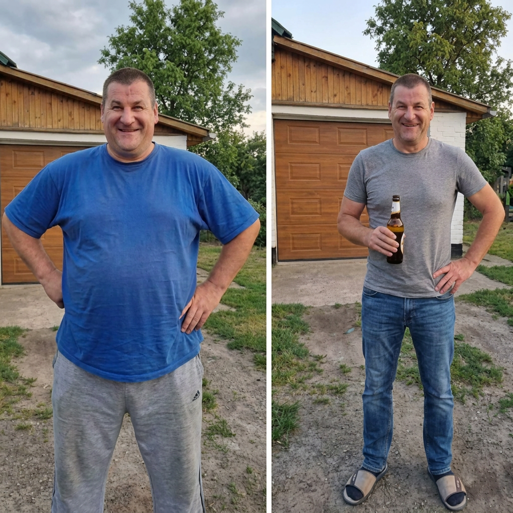

# 032 · Jacob Nash

- **Anuncio original:** [Meta · 1556907292750094](https://www.facebook.com/ads/library/?id=1556907292750094)
- **Página anunciante:** Jacob Nash · 995924326928689
- **Destino observado:** [spnutrition-us.com](https://spnutrition-us.com/pages/consumer-tested-men-listicle)
- **Categoría:** Bienestar y suplementos
- **Inicio publicado:** 2026-08-07 · 55 días de antigüedad.
- **Activo al consultar:** 2026-10-01T14:12:05.912606+00:00.
- **Ads activos globales de esa página:** aprox. 450 · [fuente](https://www.facebook.com/ads/library/?active_status=active&ad_type=all&country=ALL&is_targeted_country=false&media_type=all&search_type=page&view_all_page_id=995924326928689).
- **Consulta geográfica:** [Estados Unidos](https://www.facebook.com/ads/library/?active_status=active&ad_type=all&country=US&media_type=image&q=my+wife&search_type=keyword_unordered).
- **Longitud del texto original:** 3660 palabras; el resumen de abajo es propio.

## Apertura breve del anuncio

> If you've got a beer belly that won't budge no matter how hard you diet

## Qué desarrolla el copy

Relato de frustración con dieta y entrenamiento que incorpora historia familiar, explicación sobre magnesio y recomendación de SP Nutrition. Usa urgencia por lotes y una apelación emocional final. Datos, experiencia y transformación no verificados.

## Qué muestra la imagen

Dos fotografías de un hombre de pie al aire libre, frente a una cerca y árboles, con distinto atuendo y apariencia corporal. Sin texto añadido.

## Por qué encaja en el formato nativo

Comparativa personal de fotos cotidianas; ausencia de logo, titular, precio y CTA sobre la imagen.

## Cómo adaptar la idea

Construir una historia basada en un cambio real de rutina con fotografías propias y contexto suficiente. No atribuir una transformación a un suplemento sin evidencia ni copiar la urgencia si no es real.

## Alcance de la verificación

Actividad, fecha publicada, consulta US, conteo de la página y formato revisados. No se verificó entrega continua, rentabilidad, autoría del testimonio ni los resultados que anuncia. El dominio de destino no demuestra propiedad de la página. 
