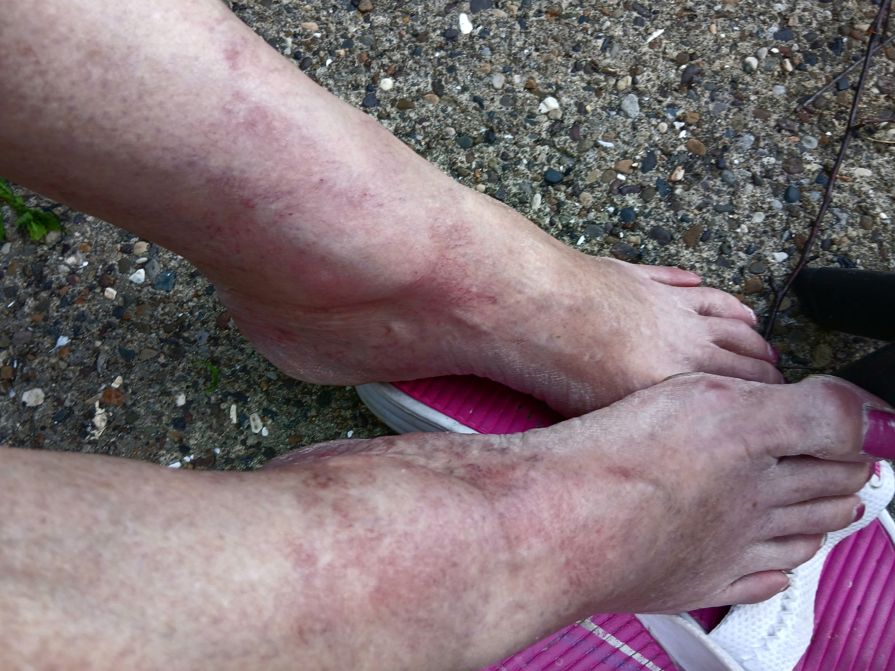

# 016 · Mama Bear Oasis

- **Anuncio original:** [Meta · 3557515594388856](https://www.facebook.com/ads/library/?id=3557515594388856)
- **Página anunciante:** Mama Bear Oasis · 100486559583411
- **Destino observado:** [mamabearoasis.com](https://mamabearoasis.com/pages/m-pdp)
- **Categoría:** Confort y movilidad
- **Inicio publicado:** 2026-04-06 · 178 días de antigüedad.
- **Activo al consultar:** 2026-10-01T14:12:05.912606+00:00.
- **Ads activos globales de esa página:** 1095 · [fuente](https://www.facebook.com/ads/library/?active_status=active&ad_type=all&country=ALL&media_type=all&search_type=page&view_all_page_id=100486559583411).
- **Consulta geográfica:** [Estados Unidos](https://www.facebook.com/ads/library/?active_status=active&ad_type=all&country=US&media_type=image&q=my+doctor&search_type=keyword_unordered).
- **Longitud del texto original:** 1625 palabras; el resumen de abajo es propio.

## Apertura breve del anuncio

> My husband begged me to cut his feet off because the burning was so bad,

## Qué desarrolla el copy

Narración dramática desde la perspectiva de la pareja de una persona con dolor: escena nocturna, intentos fallidos, explicación propuesta por el anunciante, descubrimiento de la crema y supuesto alivio. No se verificaron ni el testimonio ni sus afirmaciones médicas.

## Qué muestra la imagen

Fotografía cercana y sin retoques de diseño visibles: piernas y pies con zonas rojizas, sandalias y suelo exterior. No contiene textos superpuestos, logo, precio ni CTA.

## Por qué encaja en el formato nativo

Parece una foto personal de un problema cotidiano que contextualiza el relato largo; carece de composición de banner.

## Cómo adaptar la idea

Usar una fotografía auténtica del contexto del problema y un relato real, con autorización. Trasladar la secuencia problema→búsqueda→experiencia sin copiar promesas de curación o descalificar tratamientos.

## Alcance de la verificación

Actividad, fecha publicada, consulta US, conteo de la página y formato revisados. No se verificó entrega continua, rentabilidad, autoría del testimonio ni los resultados que anuncia. El dominio de destino no demuestra propiedad de la página. 
