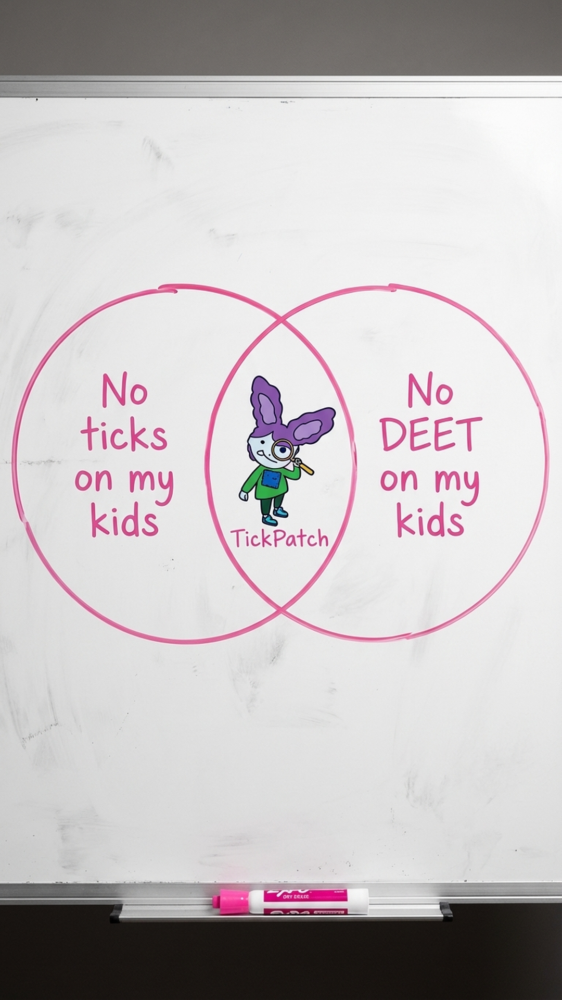

# 018 · NatPat

- **Anuncio original:** [Meta · 975387515503543](https://www.facebook.com/ads/library/?id=975387515503543)
- **Página anunciante:** NatPat · 100432571538898
- **Destino observado:** [www.natpat.com](https://www.natpat.com/pages/trailpatch?utm_source=facebook&utm_medium=social_paid&utm_campaign={{campaign.id}}_{{adset.id}})
- **Categoría:** Familia y aire libre
- **Inicio publicado:** 2026-06-25 · 98 días de antigüedad.
- **Activo al consultar:** 2026-10-01T14:05:50.037657+00:00.
- **Ads activos globales de esa página:** 1083 · [fuente](https://www.facebook.com/ads/library/?active_status=active&ad_type=all&country=ALL&media_type=all&search_type=page&view_all_page_id=100432571538898).
- **Consulta geográfica:** [Estados Unidos](https://www.facebook.com/ads/library/?active_status=active&ad_type=all&country=US&media_type=all&search_type=page&view_all_page_id=100432571538898).
- **Longitud del texto original:** 159 palabras; el resumen de abajo es propio.

## Apertura breve del anuncio

> We found a tick on our kid… and ended up spending hours in the hospital.

## Qué desarrolla el copy

Relata un susto familiar durante una salida al aire libre, presenta el parche y enumera facilidad de uso y características. El anuncio convierte una experiencia concreta en motivo para probar el producto.

## Qué muestra la imagen

Foto de una pizarra con dos círculos dibujados a mano y una pegatina en su intersección.

## Por qué encaja en el formato nativo

Parece una explicación doméstica en pizarra; no usa precio ni una composición de catálogo.

## Cómo adaptar la idea

Contar una experiencia real de uso y fotografiar una pizarra que conecte dos deseos del cliente. Verificar las prestaciones antes de publicarlas; no inventar el incidente o testimonio.

## Alcance de la verificación

Actividad, fecha publicada, consulta US, conteo de la página y formato revisados. No se verificó entrega continua, rentabilidad, autoría del testimonio ni los resultados que anuncia. El dominio de destino no demuestra propiedad de la página. 
