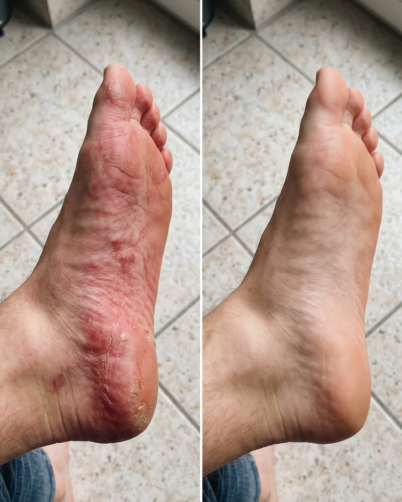

# 019 · One Compress

- **Anuncio original:** [Meta · 1566136945515968](https://www.facebook.com/ads/library/?id=1566136945515968)
- **Página anunciante:** One Compress · 100708424964575
- **Destino observado:** [www.onecompress.com](https://www.onecompress.com/products/bamboofootsleeves)
- **Categoría:** Confort y movilidad
- **Inicio publicado:** 2026-06-09 · 114 días de antigüedad.
- **Activo al consultar:** 2026-10-01T14:12:05.912606+00:00.
- **Ads activos globales de esa página:** aprox. 500 · [fuente](https://www.facebook.com/ads/library/?active_status=active&ad_type=all&country=ALL&media_type=all&search_type=page&view_all_page_id=100708424964575).
- **Consulta geográfica:** [Estados Unidos](https://www.facebook.com/ads/library/?active_status=active&ad_type=all&country=US&media_type=image&q=my+doctor&search_type=keyword_unordered).
- **Longitud del texto original:** 624 palabras; el resumen de abajo es propio.

## Apertura breve del anuncio

> I used to set an alarm 20 minutes early just so I could sit on

## Qué desarrolla el copy

Describe dolor al levantarse y varios intentos previos, introduce una recomendación y narra una rutina nocturna con mangas de compresión One Compress. El propio texto limita su promesa y termina con invitación a probar; experiencia no verificada.

## Qué muestra la imagen

Dos fotografías cercanas del costado y planta de un pie, colocadas lado a lado sobre un piso de baldosas; en una se aprecia más enrojecimiento.

## Por qué encaja en el formato nativo

Comparativa de aspecto doméstico y sin diseño tipográfico de venta. La imagen por sí sola no demuestra eficacia ni que sean condiciones equivalentes.

## Cómo adaptar la idea

Documentar una rutina auténtica y un beneficio concreto de uso, distinguiendo comodidad percibida de tratamiento. No inferir curación a partir de fotos comparativas.

## Alcance de la verificación

Actividad, fecha publicada, consulta US, conteo de la página y formato revisados. No se verificó entrega continua, rentabilidad, autoría del testimonio ni los resultados que anuncia. El dominio de destino no demuestra propiedad de la página. 
