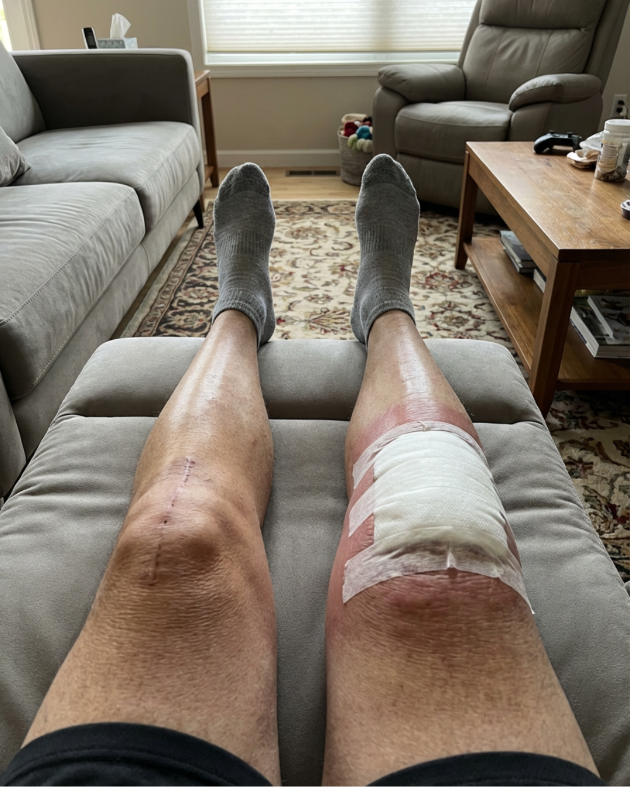

# 020 · Onecompress

- **Anuncio original:** [Meta · 2292917161196892](https://www.facebook.com/ads/library/?id=2292917161196892)
- **Página anunciante:** Onecompress · 865468883845266
- **Destino observado:** [www.onecompress.com](https://www.onecompress.com/products/bambookneesleeve)
- **Categoría:** Confort y movilidad
- **Inicio publicado:** 2026-04-10 · 174 días de antigüedad.
- **Activo al consultar:** 2026-10-01T14:12:05.912606+00:00.
- **Ads activos globales de esa página:** aprox. 760 · [fuente](https://www.facebook.com/ads/library/?active_status=active&ad_type=all&country=ALL&media_type=all&search_type=page&view_all_page_id=865468883845266).
- **Consulta geográfica:** [Estados Unidos](https://www.facebook.com/ads/library/?active_status=active&ad_type=all&country=US&media_type=image&q=my+doctor&search_type=keyword_unordered).
- **Longitud del texto original:** 594 palabras; el resumen de abajo es propio.

## Apertura breve del anuncio

> Nobody tells you that being a bigger woman means doctors treat your knee pain

## Qué desarrolla el copy

El relato se dirige a mujeres de talla grande que sienten que su dolor se reduce a su peso y que no encuentran una rodillera cómoda. Introduce una fisioterapeuta empática, destaca talles hasta 4XL y describe ajuste sin enrollarse ni pellizcar. La salida con los nietos funciona como resultado cotidiano; son afirmaciones del anunciante.

## Qué muestra la imagen

Foto de una pierna operada o marcada en un sillón. Comparte imagen con el anuncio 2366706183807356.

## Por qué encaja en el formato nativo

La foto cercana parece un registro personal de una recuperación, sin titular de oferta ni diseño de banner.

## Cómo adaptar la idea

Investigar una objeción de ajuste ignorada y mostrar talles, medidas y comodidad en cuerpos reales. Un testimonio auténtico puede sostener el ángulo de inclusión sin prometer efectos médicos.

## Alcance de la verificación

Actividad, fecha publicada, consulta US, conteo de la página y formato revisados. No se verificó entrega continua, rentabilidad, autoría del testimonio ni los resultados que anuncia. El dominio de destino no demuestra propiedad de la página. Misma foto que 2366706183807356, con un argumento de copy diferente; se conserva como variante creativa.
