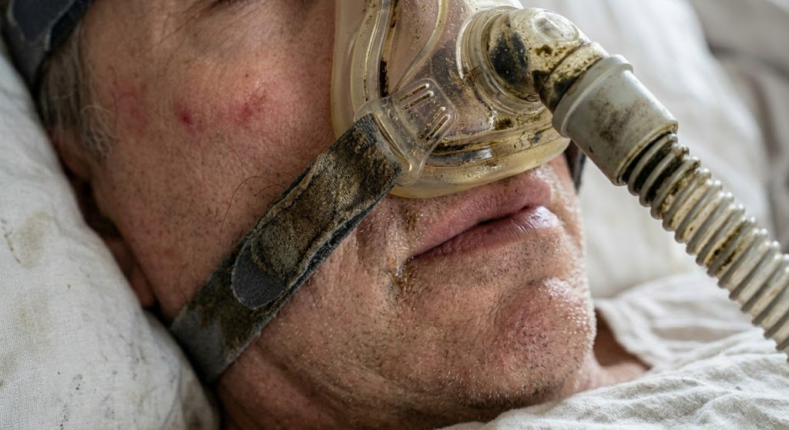

# 021 · PAP MD

- **Anuncio original:** [Meta · 1845822613469247](https://www.facebook.com/ads/library/?id=1845822613469247)
- **Página anunciante:** PAP MD · 112897251890778
- **Destino observado:** [offers.papmd.com](https://offers.papmd.com/lp010-01)
- **Categoría:** Descanso y cuidado
- **Inicio publicado:** 2026-06-26 · 97 días de antigüedad.
- **Activo al consultar:** 2026-10-01T14:12:05.912606+00:00.
- **Ads activos globales de esa página:** aprox. 490 · [fuente](https://www.facebook.com/ads/library/?active_status=active&ad_type=all&country=ALL&media_type=all&search_type=page&view_all_page_id=112897251890778).
- **Consulta geográfica:** [Estados Unidos](https://www.facebook.com/ads/library/?active_status=active&ad_type=all&country=US&media_type=image&q=my+doctor&search_type=keyword_unordered).
- **Longitud del texto original:** 537 palabras; el resumen de abajo es propio.

## Apertura breve del anuncio

> When I first started CPAP everything was great. I started sleeping better, and for the

## Qué desarrolla el copy

Testimonio que pasa de una buena experiencia inicial con CPAP a molestias, atribuye el problema al aire y recomienda un filtro PAP MD. Describe instalación, compatibilidad y garantía, y cierra con descuento. Prestaciones y afirmaciones sanitarias no verificadas.

## Qué muestra la imagen

Primer plano lateral de una persona acostada con una máscara de CPAP y tubo; sábanas y parte de la cara visibles. Sin mensajes promocionales superpuestos.

## Por qué encaja en el formato nativo

Imagen contextual de uso cotidiano de un dispositivo, con apariencia documental y sin gráfica de banner.

## Cómo adaptar la idea

Mostrar el accesorio en su entorno de uso y explicar una necesidad real con instrucciones y compatibilidad verificadas del fabricante. Mantener separadas experiencia personal y afirmaciones sanitarias.

## Alcance de la verificación

Actividad, fecha publicada, consulta US, conteo de la página y formato revisados. No se verificó entrega continua, rentabilidad, autoría del testimonio ni los resultados que anuncia. El dominio de destino no demuestra propiedad de la página. 
