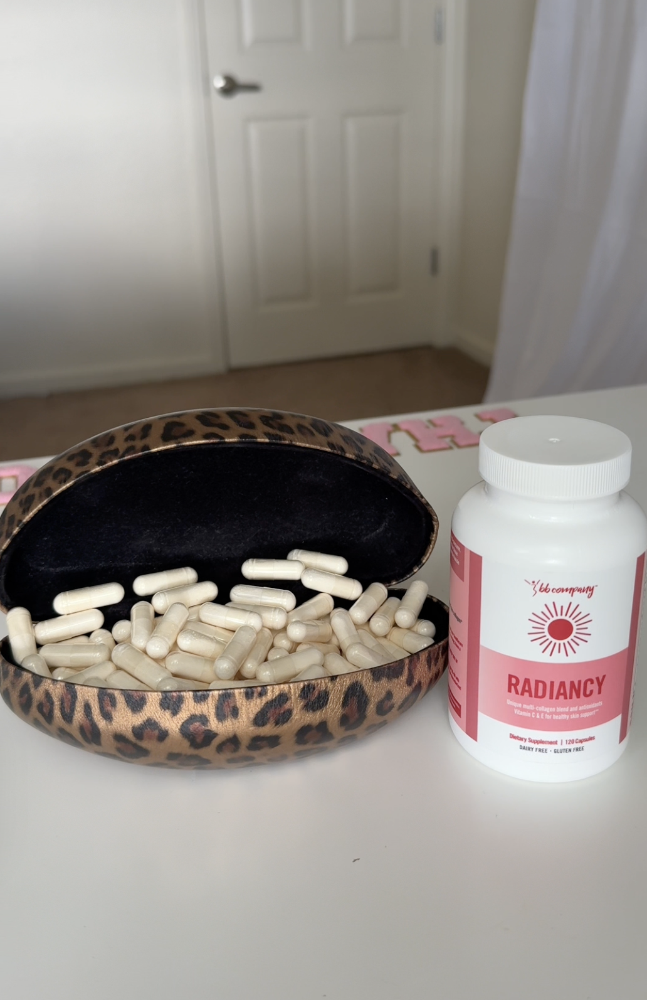

# 034 · Radiancy

- **Anuncio original:** [Meta · 4469850073159061](https://www.facebook.com/ads/library/?id=4469850073159061)
- **Página anunciante:** Radiancy · 409588712234260
- **Destino observado:** [thebbco.com](https://thebbco.com/pages/radiancy-quiz-flow-2-bof)
- **Categoría:** Cuidado personal
- **Inicio publicado:** 2026-07-10 · 83 días de antigüedad.
- **Activo al consultar:** 2026-10-01T14:12:33.136637+00:00.
- **Ads activos globales de esa página:** aprox. 560 · [fuente](https://www.facebook.com/ads/library/?active_status=active&ad_type=all&country=ALL&media_type=all&search_type=page&view_all_page_id=409588712234260).
- **Consulta geográfica:** [Estados Unidos](https://www.facebook.com/ads/library/?active_status=active&ad_type=all&country=US&media_type=all&search_type=page&view_all_page_id=409588712234260).
- **Longitud del texto original:** 445 palabras; el resumen de abajo es propio.

## Apertura breve del anuncio

> Found a Sneaky Loophole to Get 25% Off Radiancy—Here’s How to Claim It… ======== Go to

## Qué desarrolla el copy

Presenta instrucciones promocionales para elegir un suministro de 90 días y aplicar un cupón. Después introduce la garantía de devolución, explica la fórmula según la marca y reúne testimonios; cierra con descuento y urgencia. El copy no identifica a una usuaria como narradora principal; las afirmaciones de salud y los testimonios no están verificados.

## Qué muestra la imagen

Frasco y cápsulas en un pequeño recipiente junto a una puerta, fotografiados sobre una superficie doméstica.

## Por qué encaja en el formato nativo

Foto de apariencia cotidiana, con objetos o producto en contexto y sin diseño de banner; el texto largo desarrolla un argumento completo.

## Cómo adaptar la idea

Mostrar una foto real de uso y explicar un ahorro que exista, con pasos y condiciones transparentes. Conservar el tono de hallazgo sin inventar escasez ni presentar afirmaciones de salud como prueba.

## Alcance de la verificación

Actividad, fecha publicada, consulta US, conteo de la página y formato revisados. No se verificó entrega continua, rentabilidad, autoría del testimonio ni los resultados que anuncia. El dominio de destino no demuestra propiedad de la página. 
