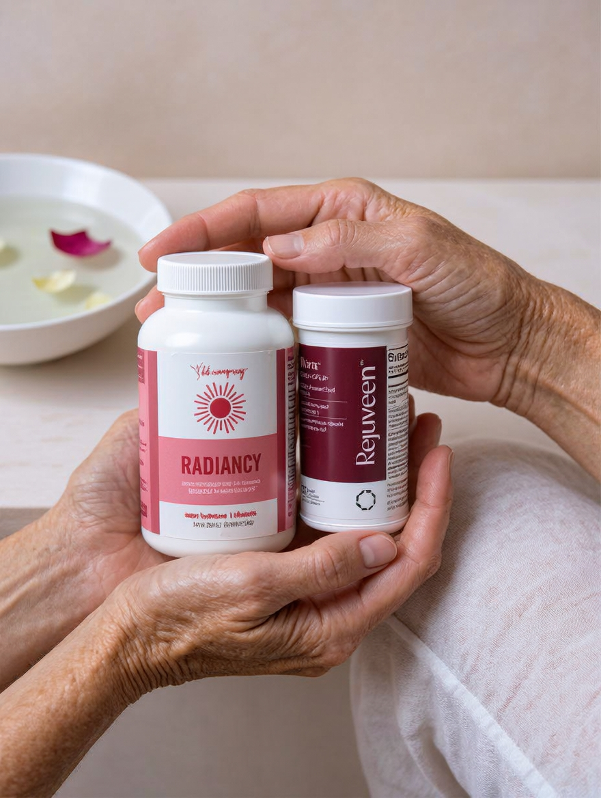

# 042 · Radiancy

- **Anuncio original:** [Meta · 1631874972280959](https://www.facebook.com/ads/library/?id=1631874972280959)
- **Página anunciante:** Radiancy · 409588712234260
- **Destino observado:** [thebbco.com](https://thebbco.com/pages/radiancy-quiz-flow-2-bof)
- **Categoría:** Cuidado personal
- **Inicio publicado:** 2026-07-15 · 78 días de antigüedad.
- **Activo al consultar:** 2026-10-01T14:12:33.136637+00:00.
- **Ads activos globales de esa página:** aprox. 560 · [fuente](https://www.facebook.com/ads/library/?active_status=active&ad_type=all&country=ALL&media_type=all&search_type=page&view_all_page_id=409588712234260).
- **Consulta geográfica:** [Estados Unidos](https://www.facebook.com/ads/library/?active_status=active&ad_type=all&country=US&media_type=all&search_type=page&view_all_page_id=409588712234260).
- **Longitud del texto original:** 1008 palabras; el resumen de abajo es propio.

## Apertura breve del anuncio

> Everyone Who's Planning to Try Radiancy Needs to Know These 6 Unexpected (But Welcome!) "Side Effects"

## Qué desarrolla el copy

Presenta seis supuestos beneficios adicionales como sorpresa: comodidad íntima, confianza, relación de pareja, bienestar y apariencia. Alterna pequeñas escenas personales con explicaciones e ingredientes atribuidos a la marca. Termina con una invitación a comprar o completar un cuestionario.

## Qué muestra la imagen

Manos sostienen dos envases frente al torso de una persona, en una foto de cerca y sin titular.

## Por qué encaja en el formato nativo

Foto de apariencia cotidiana, con objetos o producto en contexto y sin diseño de banner; el texto largo desarrolla un argumento completo.

## Cómo adaptar la idea

Crear una lista de usos o beneficios demostrables, cada uno unido a una pequeña escena cotidiana. Probar distintas fotos domésticas manteniendo el argumento y registrar cada variante visual.

## Alcance de la verificación

Actividad, fecha publicada, consulta US, conteo de la página y formato revisados. No se verificó entrega continua, rentabilidad, autoría del testimonio ni los resultados que anuncia. El dominio de destino no demuestra propiedad de la página. 
