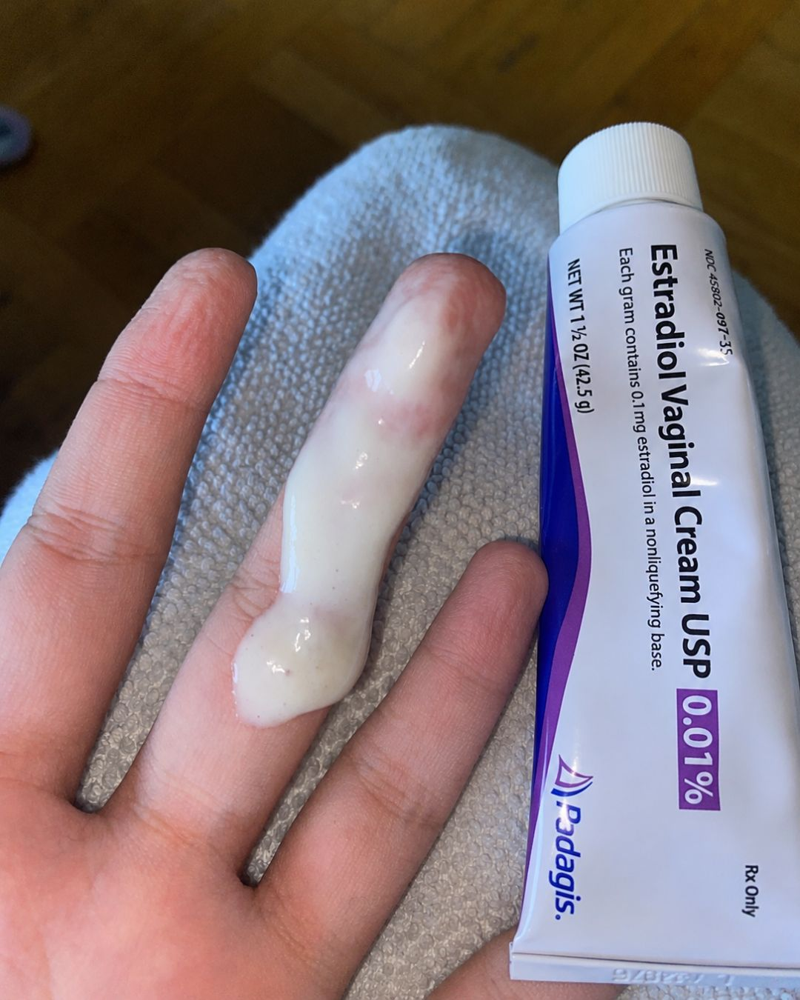

# 054 · Radiancy

- **Anuncio original:** [Meta · 1612122007177084](https://www.facebook.com/ads/library/?id=1612122007177084)
- **Página anunciante:** Radiancy · 409588712234260
- **Destino observado:** [thebbco.com](https://thebbco.com/pages/ps-radiancy-listicle-dryness-sns-v8-frmd)
- **Categoría:** Cuidado personal
- **Inicio publicado:** 2026-07-29 · 64 días de antigüedad.
- **Activo al consultar:** 2026-10-01T14:12:33.136637+00:00.
- **Ads activos globales de esa página:** aprox. 560 · [fuente](https://www.facebook.com/ads/library/?active_status=active&ad_type=all&country=ALL&media_type=all&search_type=page&view_all_page_id=409588712234260).
- **Consulta geográfica:** [Estados Unidos](https://www.facebook.com/ads/library/?active_status=active&ad_type=all&country=US&media_type=all&search_type=page&view_all_page_id=409588712234260).
- **Longitud del texto original:** 2242 palabras; el resumen de abajo es propio.

## Apertura breve del anuncio

> A couple UTIs spread and almost killed me, other times the tests came back negative, so

## Qué desarrolla el copy

Una narradora describe la muerte de su madre y su propia urgencia médica por infecciones. Una consulta introduce el mecanismo comercial de tres sistemas; siguen búsqueda de producto, comparación de gastos, cronología de mejoría y cierre familiar. Son afirmaciones y escenas del anuncio, no hechos clínicos comprobados.

## Qué muestra la imagen

Una mano muestra crema sobre un dedo junto a un tubo de estradiol apoyado sobre la pierna con ropa.

## Por qué encaja en el formato nativo

Foto de apariencia cotidiana, con objetos o producto en contexto y sin diseño de banner; el texto largo desarrolla un argumento completo.

## Cómo adaptar la idea

Tomar solo la estructura narrativa: situación concreta, intentos anteriores, descubrimiento y cierre que retoma el comienzo. Usar una historia real y evitar copiar miedo clínico, desaconsejar tratamientos o atribuir curas a un suplemento.

## Alcance de la verificación

Actividad, fecha publicada, consulta US, conteo de la página y formato revisados. No se verificó entrega continua, rentabilidad, autoría del testimonio ni los resultados que anuncia. El dominio de destino no demuestra propiedad de la página. Misma foto que 1032403039580531, 1314022333890953, con un argumento de copy diferente; se conserva como variante creativa.
