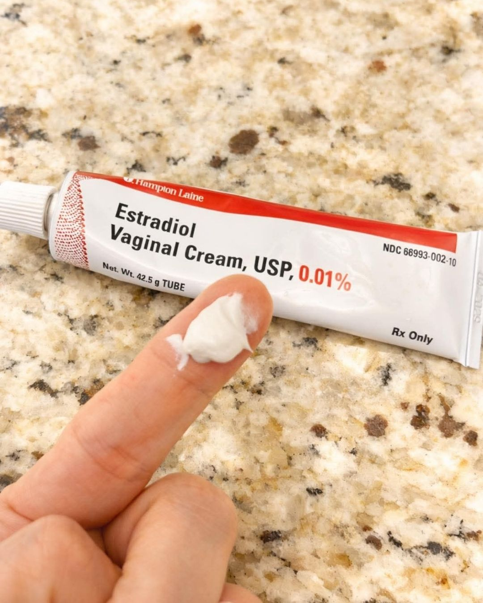

# 073 · Radiancy

- **Anuncio original:** [Meta · 27834571319525989](https://www.facebook.com/ads/library/?id=27834571319525989)
- **Página anunciante:** Radiancy · 409588712234260
- **Destino observado:** [thebbco.com](https://thebbco.com/pages/ps-radiancy-listicle-dryness-sns-v8-frmd)
- **Categoría:** Cuidado personal
- **Inicio publicado:** 2026-08-12 · 50 días de antigüedad.
- **Activo al consultar:** 2026-10-01T14:12:33.136637+00:00.
- **Ads activos globales de esa página:** aprox. 560 · [fuente](https://www.facebook.com/ads/library/?active_status=active&ad_type=all&country=ALL&media_type=all&search_type=page&view_all_page_id=409588712234260).
- **Consulta geográfica:** [Estados Unidos](https://www.facebook.com/ads/library/?active_status=active&ad_type=all&country=US&media_type=all&search_type=page&view_all_page_id=409588712234260).
- **Longitud del texto original:** 1511 palabras; el resumen de abajo es propio.

## Apertura breve del anuncio

> The nurse made a point to tell me I wasn't in peri or menopause because the

## Qué desarrolla el copy

Relato de dolor íntimo y distancia de pareja: varios intentos fallan, una especialista plantea un mecanismo de tres sistemas y la narradora compara gastos antes de probar el producto. La cronología y el desenlace emocional se usan como persuasión, sin verificar eficacia.

## Qué muestra la imagen

Un dedo con crema frente a un tubo de estradiol sobre una mesada moteada.

## Por qué encaja en el formato nativo

Foto de apariencia cotidiana, con objetos o producto en contexto y sin diseño de banner; el texto largo desarrolla un argumento completo.

## Cómo adaptar la idea

Conectar un problema funcional con su costo cotidiano y relacional, explicar una solución comprobable y cerrar con una escena concreta. No copiar especialistas ficticios ni promesas de tratamiento.

## Alcance de la verificación

Actividad, fecha publicada, consulta US, conteo de la página y formato revisados. No se verificó entrega continua, rentabilidad, autoría del testimonio ni los resultados que anuncia. El dominio de destino no demuestra propiedad de la página. Misma foto que 2127143527869104, con un argumento de copy diferente; se conserva como variante creativa.
