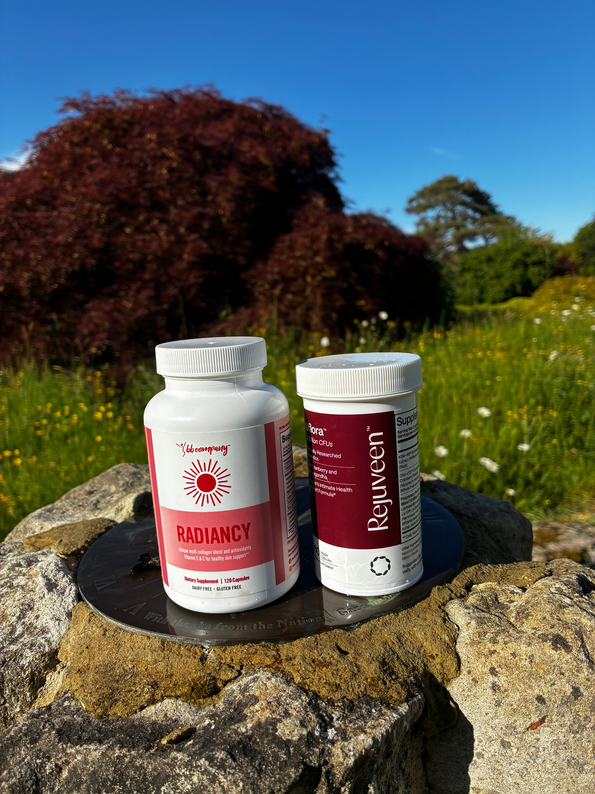

# 083 · Radiancy

- **Anuncio original:** [Meta · 2877366245960233](https://www.facebook.com/ads/library/?id=2877366245960233)
- **Página anunciante:** Radiancy · 409588712234260
- **Destino observado:** [thebbco.com](https://thebbco.com/pages/pp-radiancy-bof-sns)
- **Categoría:** Cuidado personal
- **Inicio publicado:** 2026-08-15 · 47 días de antigüedad.
- **Activo al consultar:** 2026-10-01T14:12:33.136637+00:00.
- **Ads activos globales de esa página:** aprox. 560 · [fuente](https://www.facebook.com/ads/library/?active_status=active&ad_type=all&country=ALL&media_type=all&search_type=page&view_all_page_id=409588712234260).
- **Consulta geográfica:** [Estados Unidos](https://www.facebook.com/ads/library/?active_status=active&ad_type=all&country=US&media_type=all&search_type=page&view_all_page_id=409588712234260).
- **Longitud del texto original:** 491 palabras; el resumen de abajo es propio.

## Apertura breve del anuncio

> "It helped with my vaginal dryness, and my doctor said my vaginal wall looks better. Helped

## Qué desarrolla el copy

Abre con un testimonio sobre resultados atribuidos al producto y continúa con un paso a paso de ahorro, ingredientes, otras opiniones y garantía. Combina prueba social con instrucciones concretas de compra; los resultados médicos relatados no están verificados.

## Qué muestra la imagen

Dos envases apoyados en piedras al aire libre, con césped, árboles y cielo azul al fondo.

## Por qué encaja en el formato nativo

Foto de apariencia cotidiana, con objetos o producto en contexto y sin diseño de banner; el texto largo desarrolla un argumento completo.

## Cómo adaptar la idea

Combinar una opinión auténtica y autorizada con una explicación verificable de la oferta. Usar foto real del producto en contexto; no inventar clientes, avales o resultados médicos.

## Alcance de la verificación

Actividad, fecha publicada, consulta US, conteo de la página y formato revisados. No se verificó entrega continua, rentabilidad, autoría del testimonio ni los resultados que anuncia. El dominio de destino no demuestra propiedad de la página. 
