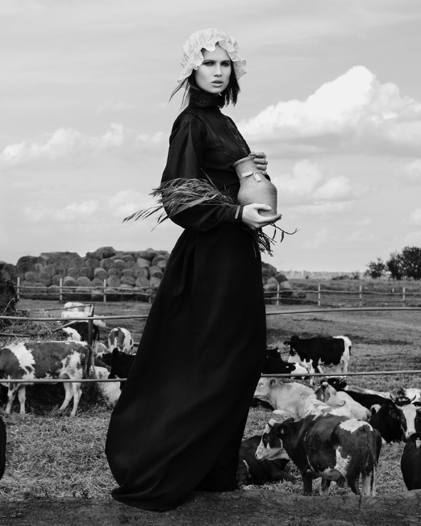

# 089 · Radiancy

- **Anuncio original:** [Meta · 3109995369182454](https://www.facebook.com/ads/library/?id=3109995369182454)
- **Página anunciante:** Radiancy · 409588712234260
- **Destino observado:** [thebbco.com](https://thebbco.com/pages/ps-radiancy-listicle-dryness-sns-v8-frmd)
- **Categoría:** Cuidado personal
- **Inicio publicado:** 2026-08-20 · 42 días de antigüedad.
- **Activo al consultar:** 2026-10-01T14:12:33.136637+00:00.
- **Ads activos globales de esa página:** aprox. 560 · [fuente](https://www.facebook.com/ads/library/?active_status=active&ad_type=all&country=ALL&media_type=all&search_type=page&view_all_page_id=409588712234260).
- **Consulta geográfica:** [Estados Unidos](https://www.facebook.com/ads/library/?active_status=active&ad_type=all&country=US&media_type=all&search_type=page&view_all_page_id=409588712234260).
- **Longitud del texto original:** 2753 palabras; el resumen de abajo es propio.

## Apertura breve del anuncio

> A Mormon grandmother fixed my vaginal dryness with 3 things from her food storage... No estrogen.

## Qué desarrolla el copy

La narradora, afín a productos naturales, cuenta una conversación con una abuela y luego con su hija médica. Objetos de una despensa funcionan como metáforas de tres sistemas. La búsqueda del suplemento, resultados atribuidos y retorno a la escena inicial completan el relato.

## Qué muestra la imagen

Imagen de apariencia fotográfica en blanco y negro: mujer con vestido largo de pie en un paisaje rural con animales.

## Por qué encaja en el formato nativo

Imagen de apariencia fotográfica y función editorial, sin precio ni titular comercial dominante; acompaña un relato extenso. La escena por sí sola no demuestra que la historia sea real.

## Cómo adaptar la idea

Una conversación real con alguien experimentado puede introducir una idea compleja mediante objetos cotidianos. Cerrar volviendo a esa persona; no inventar tradiciones, médicos, estadísticas ni curas.

## Alcance de la verificación

Actividad, fecha publicada, consulta US, conteo de la página y formato revisados. No se verificó entrega continua, rentabilidad, autoría del testimonio ni los resultados que anuncia. El dominio de destino no demuestra propiedad de la página. 
