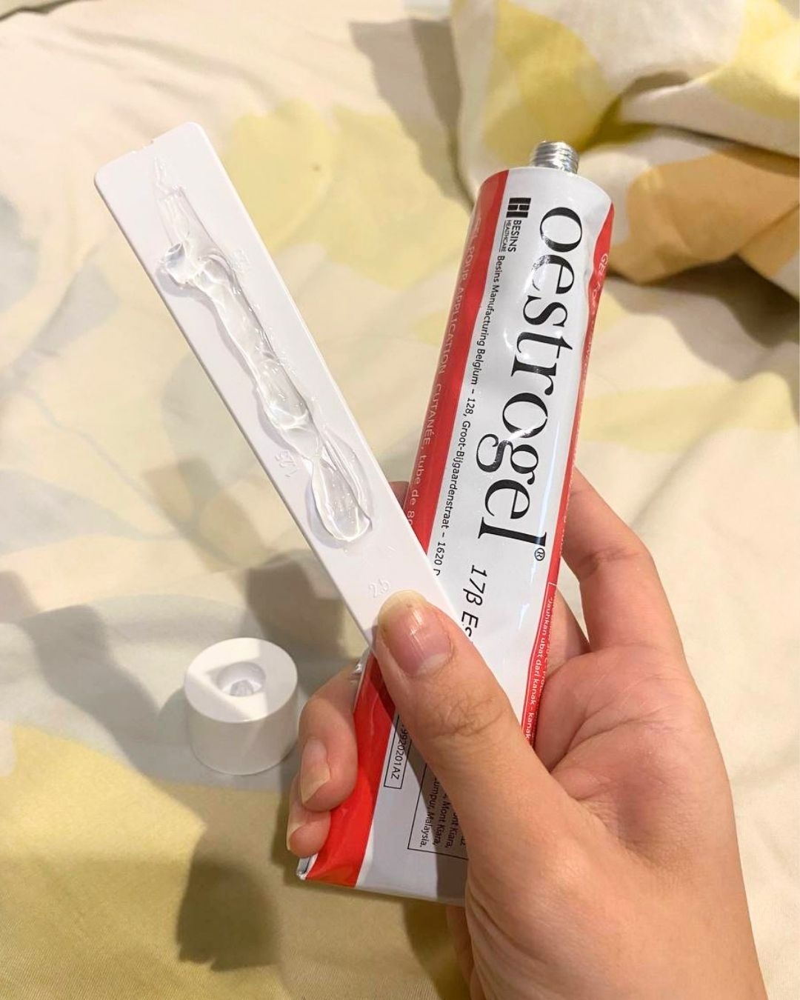

# 091 · Radiancy

- **Anuncio original:** [Meta · 2626755854431486](https://www.facebook.com/ads/library/?id=2626755854431486)
- **Página anunciante:** Radiancy · 409588712234260
- **Destino observado:** [thebbco.com](https://thebbco.com/pages/ps-radiancy-listicle-dryness-sns-v8-frmd)
- **Categoría:** Cuidado personal
- **Inicio publicado:** 2026-08-24 · 38 días de antigüedad.
- **Activo al consultar:** 2026-10-01T14:12:33.136637+00:00.
- **Ads activos globales de esa página:** aprox. 560 · [fuente](https://www.facebook.com/ads/library/?active_status=active&ad_type=all&country=ALL&media_type=all&search_type=page&view_all_page_id=409588712234260).
- **Consulta geográfica:** [Estados Unidos](https://www.facebook.com/ads/library/?active_status=active&ad_type=all&country=US&media_type=all&search_type=page&view_all_page_id=409588712234260).
- **Longitud del texto original:** 986 palabras; el resumen de abajo es propio.

## Apertura breve del anuncio

> I used to love oral sex… until my clitoris shrunk and I can’t ‘cum’ anymore. Im

## Qué desarrolla el copy

Relato sobre pérdida de sensibilidad y frustración que contrasta la atención recibida por hombres y mujeres. Una especialista introduce el mecanismo comercial de tres sistemas; el producto aparece como descubrimiento y la historia termina en recuperación íntima atribuida a su uso.

## Qué muestra la imagen

Una mano sostiene envases de Oestrogel sobre una tela clara, con encuadre casual y sin titular.

## Por qué encaja en el formato nativo

Foto de apariencia cotidiana, con objetos o producto en contexto y sin diseño de banner; el texto largo desarrolla un argumento completo.

## Cómo adaptar la idea

Usar la tensión entre expectativa y experiencia para escuchar una frustración real. Adaptar con evidencia del producto y testimonios auténticos; no replicar cifras, diagnósticos o autoridad médica no comprobados.

## Alcance de la verificación

Actividad, fecha publicada, consulta US, conteo de la página y formato revisados. No se verificó entrega continua, rentabilidad, autoría del testimonio ni los resultados que anuncia. El dominio de destino no demuestra propiedad de la página. 
