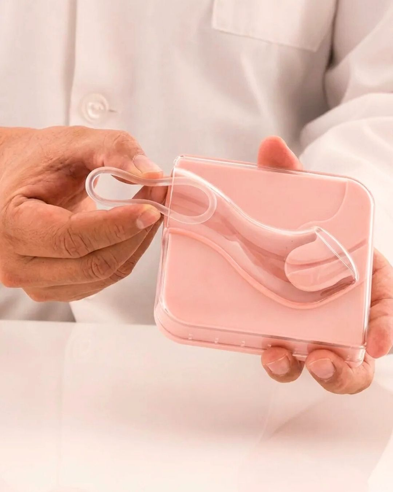

# 093 · Radiancy

- **Anuncio original:** [Meta · 4588800214737486](https://www.facebook.com/ads/library/?id=4588800214737486)
- **Página anunciante:** Radiancy · 409588712234260
- **Destino observado:** [thebbco.com](https://thebbco.com/pages/ps-radiancy-listicle-dryness-pt)
- **Categoría:** Cuidado personal
- **Inicio publicado:** 2026-08-29 · 33 días de antigüedad.
- **Activo al consultar:** 2026-10-01T14:12:33.136637+00:00.
- **Ads activos globales de esa página:** aprox. 560 · [fuente](https://www.facebook.com/ads/library/?active_status=active&ad_type=all&country=ALL&media_type=all&search_type=page&view_all_page_id=409588712234260).
- **Consulta geográfica:** [Estados Unidos](https://www.facebook.com/ads/library/?active_status=active&ad_type=all&country=US&media_type=all&search_type=page&view_all_page_id=409588712234260).
- **Longitud del texto original:** 2235 palabras; el resumen de abajo es propio.

## Apertura breve del anuncio

> When sex feels like 1000 paper cuts, "use more lube" is like pouring vinegar on an

## Qué desarrolla el copy

Relato de dolor íntimo y distancia de pareja: varios intentos fallan, una especialista plantea un mecanismo de tres sistemas y la narradora compara gastos antes de probar el producto. La cronología y el desenlace emocional se usan como persuasión, sin verificar eficacia.

## Qué muestra la imagen

Persona con bata blanca sostiene un modelo anatómico de la pelvis y lo señala con la otra mano.

## Por qué encaja en el formato nativo

Imagen de apariencia fotográfica y función editorial, sin precio ni titular comercial dominante; acompaña un relato extenso. La escena por sí sola no demuestra que la historia sea real.

## Cómo adaptar la idea

Conectar un problema funcional con su costo cotidiano y relacional, explicar una solución comprobable y cerrar con una escena concreta. No copiar especialistas ficticios ni promesas de tratamiento.

## Alcance de la verificación

Actividad, fecha publicada, consulta US, conteo de la página y formato revisados. No se verificó entrega continua, rentabilidad, autoría del testimonio ni los resultados que anuncia. El dominio de destino no demuestra propiedad de la página. Misma foto que 1706476500616761, 2937439103275960, con un argumento de copy diferente; se conserva como variante creativa.
