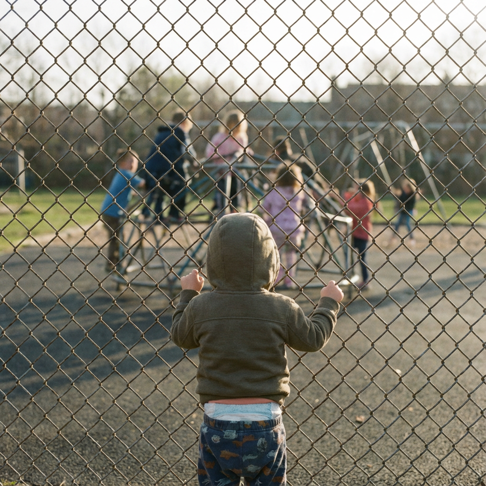

# 023 · Raising Toddlers with Bec

- **Anuncio original:** [Meta · 1416810516666498](https://www.facebook.com/ads/library/?id=1416810516666498)
- **Página anunciante:** Raising Toddlers with Bec · 961109957075226
- **Destino observado:** [www.upairy.com](https://www.upairy.com/pages/training-underwear)
- **Categoría:** Familia y crianza
- **Inicio publicado:** 2026-01-14 · 260 días de antigüedad.
- **Activo al consultar:** 2026-10-01T14:12:05.912606+00:00.
- **Ads activos globales de esa página:** 281 · [fuente](https://www.facebook.com/ads/library/?active_status=active&ad_type=all&country=ALL&media_type=all&search_type=page&view_all_page_id=961109957075226).
- **Consulta geográfica:** [Estados Unidos](https://www.facebook.com/ads/library/?active_status=active&ad_type=all&country=US&media_type=image&q=I+thought&search_type=keyword_unordered).
- **Longitud del texto original:** 622 palabras; el resumen de abajo es propio.

## Apertura breve del anuncio

> We lost my daughter's preschool spot. They called two weeks ago and said if

## Qué desarrolla el copy

La narradora dice haber perdido una plaza de preescolar y estar ante una nueva fecha límite. Descubre UpAiry en una conversación de padres, relata accidentes y avances durante 16 días y termina con la confirmación de la plaza. El producto se conecta con una consecuencia concreta; la experiencia no fue autenticada.

## Qué muestra la imagen

Niño observado desde atrás, mirando un área de juego al otro lado de un alambrado.

## Por qué encaja en el formato nativo

La foto sugiere estar mirando una actividad desde afuera y acompaña un relato parental, sin producto ni texto publicitario encima.

## Cómo adaptar la idea

Relacionar una fricción real con una ocasión de uso concreta y mostrar cómo se prepara la familia. Evitar generalizar requisitos escolares o inventar exclusiones para aumentar urgencia.

## Alcance de la verificación

Actividad, fecha publicada, consulta US, conteo de la página y formato revisados. No se verificó entrega continua, rentabilidad, autoría del testimonio ni los resultados que anuncia. El dominio de destino no demuestra propiedad de la página. 
