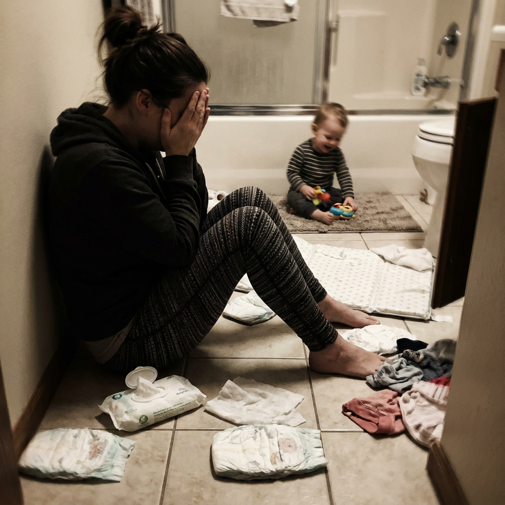

# 035 · Raising Toddlers with Bec

- **Anuncio original:** [Meta · 3053238634847995](https://www.facebook.com/ads/library/?id=3053238634847995)
- **Página anunciante:** Raising Toddlers with Bec · 961109957075226
- **Destino observado:** [www.upairy.com](https://www.upairy.com/pages/training-underwear)
- **Categoría:** Familia y crianza
- **Inicio publicado:** 2026-01-20 · 254 días de antigüedad.
- **Activo al consultar:** 2026-10-01T14:12:05.912606+00:00.
- **Ads activos globales de esa página:** 281 · [fuente](https://www.facebook.com/ads/library/?active_status=active&ad_type=all&country=ALL&media_type=all&search_type=page&view_all_page_id=961109957075226).
- **Consulta geográfica:** [Estados Unidos](https://www.facebook.com/ads/library/?active_status=active&ad_type=all&country=US&media_type=image&q=I+thought&search_type=keyword_unordered).
- **Longitud del texto original:** 1398 palabras; el resumen de abajo es propio.

## Apertura breve del anuncio

> **Please STOP using diapers when potty training your toddler.** I know that sounds backwards,

## Qué desarrolla el copy

El copy presenta meses de intentos de dejar pañales y la presión de una fecha de inicio del preescolar. Una terapeuta en el relato explica la supuesta falta de señal de humedad; UpAiry aparece como solución intermedia. Una cronología de cuatro semanas conduce al alivio de llegar a tiempo. Los plazos son alegaciones del anuncio.

## Qué muestra la imagen

Madre sentada en el suelo del baño con una niña y ropa cerca.

## Por qué encaja en el formato nativo

Escena doméstica de crianza que parece acompañar una confesión o pedido de ayuda en una comunidad de padres.

## Cómo adaptar la idea

Usar una escena cotidiana y una dificultad específica respaldada por entrevistas reales. Explicar de forma demostrable cómo se usa el producto; no presionar con vergüenza ni prometer un plazo de desarrollo infantil.

## Alcance de la verificación

Actividad, fecha publicada, consulta US, conteo de la página y formato revisados. No se verificó entrega continua, rentabilidad, autoría del testimonio ni los resultados que anuncia. El dominio de destino no demuestra propiedad de la página. 
