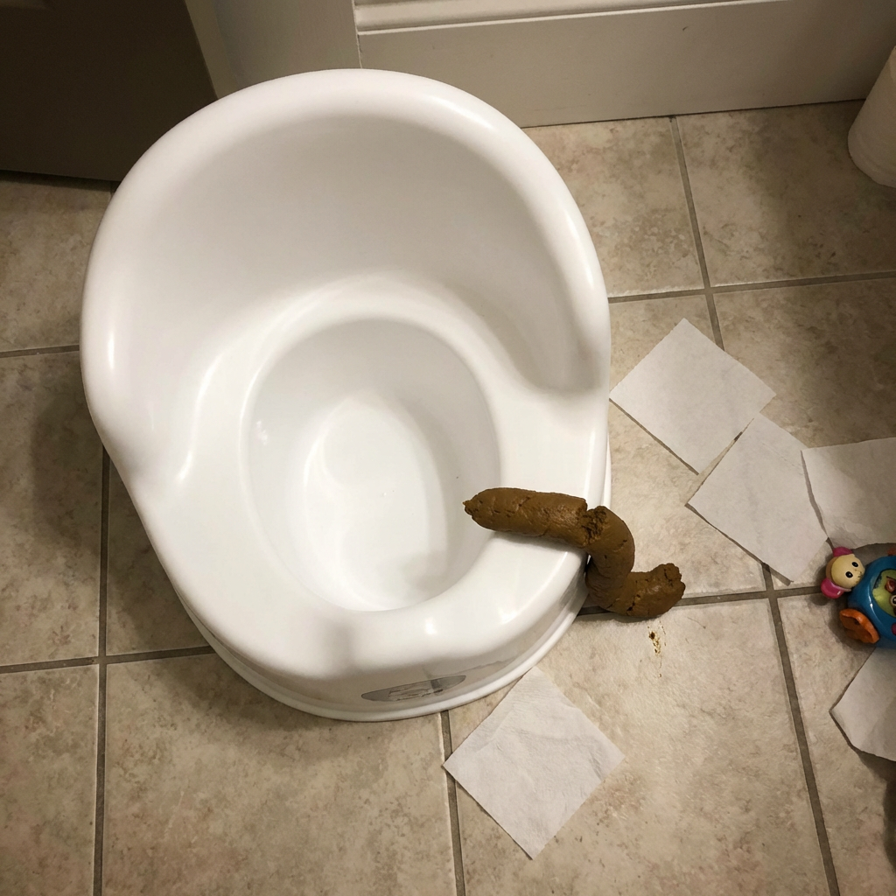

# 043 · Raising Toddlers with Bec

- **Anuncio original:** [Meta · 742321081988365](https://www.facebook.com/ads/library/?id=742321081988365)
- **Página anunciante:** Raising Toddlers with Bec · 961109957075226
- **Destino observado:** [www.upairy.com](https://www.upairy.com/pages/training-underwear)
- **Categoría:** Familia y crianza
- **Inicio publicado:** 2026-02-05 · 238 días de antigüedad.
- **Activo al consultar:** 2026-10-01T14:12:05.912606+00:00.
- **Ads activos globales de esa página:** 281 · [fuente](https://www.facebook.com/ads/library/?active_status=active&ad_type=all&country=ALL&media_type=all&search_type=page&view_all_page_id=961109957075226).
- **Consulta geográfica:** [Estados Unidos](https://www.facebook.com/ads/library/?active_status=active&ad_type=all&country=US&media_type=image&q=I+thought&search_type=keyword_unordered).
- **Longitud del texto original:** 1026 palabras; el resumen de abajo es propio.

## Apertura breve del anuncio

> My best friend's daughter potty trained in 3 days, while mine took over a year.

## Qué desarrolla el copy

Compara el supuesto proceso de dos niñas de edad similar; describe frustración, incorpora una explicación sensorial atribuida a una especialista, presenta el producto y cierra con historias de otras madres y enlace. Son afirmaciones publicitarias no verificadas.

## Qué muestra la imagen

Fotografía doméstica de una bacinica blanca junto al inodoro, con un accidente visible, papel en el piso y un pequeño juguete. Sin textos superpuestos ni marca.

## Por qué encaja en el formato nativo

Escena imperfecta y concreta de la vida cotidiana, coherente con una publicación personal sobre una dificultad; no parece banner.

## Cómo adaptar la idea

Abrir con una escena real del problema y contar qué intentó la persona, qué cambió y qué observó. Usar comparaciones y tiempos sólo si son verificables y representativos.

## Alcance de la verificación

Actividad, fecha publicada, consulta US, conteo de la página y formato revisados. No se verificó entrega continua, rentabilidad, autoría del testimonio ni los resultados que anuncia. El dominio de destino no demuestra propiedad de la página. 
