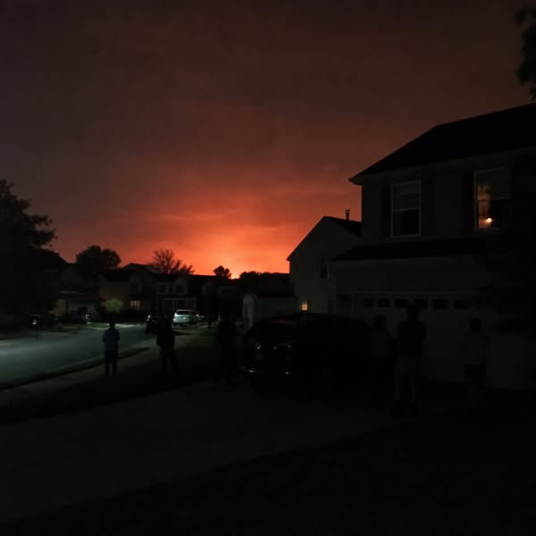

# 024 · Ready Nation USA

- **Anuncio original:** [Meta · 1538659214620613](https://www.facebook.com/ads/library/?id=1538659214620613)
- **Página anunciante:** Ready Nation USA · 1108073152395957
- **Destino observado:** [guardsurvival.com](https://guardsurvival.com/pages/radio)
- **Categoría:** Hogar y preparación
- **Inicio publicado:** 2026-06-17 · 106 días de antigüedad.
- **Activo al consultar:** 2026-10-01T14:24:53.328Z.
- **Ads activos globales de esa página:** aprox. 2800 · [fuente](https://www.facebook.com/ads/library/?active_status=active&ad_type=all&country=ALL&media_type=all&search_type=page&view_all_page_id=1108073152395957).
- **Consulta geográfica:** [Estados Unidos](https://www.facebook.com/ads/library/?active_status=active&ad_type=all&country=US&is_targeted_country=false&media_type=image&search_type=page&sort_data[mode]=total_impressions&sort_data[direction]=desc&view_all_page_id=1108073152395957).
- **Longitud del texto original:** 1600 palabras; el resumen de abajo es propio.

## Apertura breve del anuncio

> The power went out at 11:47 PM on a Wednesday and I'm standing in my driveway

## Qué desarrolla el copy

Cuenta una escena nocturna de apagón desde la experiencia de una familia y un vecino que aparece con una radio. El contraste entre desconocer qué ocurre y disponer de información conduce a la solución comercial. Es una historia testimonial del anunciante; no se verificaron sus personajes ni las explicaciones de ataques o alertas oficiales.

## Qué muestra la imagen

Calle residencial oscura de noche, con siluetas de casas y resplandor naranja o rojizo en el horizonte.

## Por qué encaja en el formato nativo

Escena u objeto del entorno cotidiano, presentado como observación personal y acompañado de un relato extenso. No usa un banner de oferta; la autenticidad de la historia no está comprobada.

## Cómo adaptar la idea

Contar una experiencia auténtica de un corte de luz y la acción concreta de un vecino o familiar, con su permiso. Cerrar con una demostración útil, sin inventar causas militares o alertas oficiales.

## Alcance de la verificación

Actividad, fecha publicada, consulta US, conteo de la página y formato revisados. No se verificó entrega continua, rentabilidad, autoría del testimonio ni los resultados que anuncia. El dominio de destino no demuestra propiedad de la página. Sin desglose de placements conservado: se verificó la consulta Meta para Estados Unidos.
