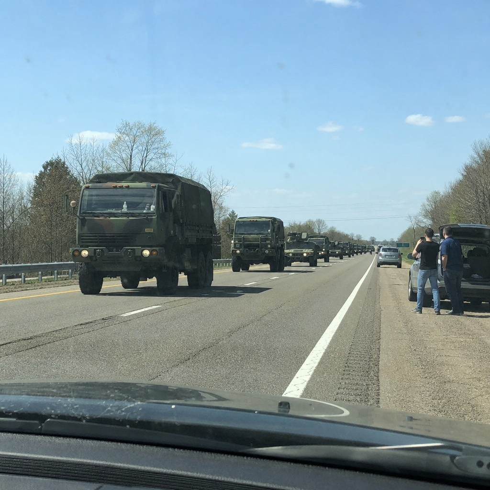

# 036 · Ready Nation USA

- **Anuncio original:** [Meta · 813272311722012](https://www.facebook.com/ads/library/?id=813272311722012)
- **Página anunciante:** Ready Nation USA · 1108073152395957
- **Destino observado:** [guardsurvival.com](https://guardsurvival.com/pages/radio)
- **Categoría:** Hogar y preparación
- **Inicio publicado:** 2026-06-17 · 106 días de antigüedad.
- **Activo al consultar:** 2026-10-01T14:12:05.912606+00:00.
- **Ads activos globales de esa página:** aprox. 2800 · [fuente](https://www.facebook.com/ads/library/?active_status=active&ad_type=all&country=ALL&media_type=all&search_type=page&view_all_page_id=1108073152395957).
- **Consulta geográfica:** [Estados Unidos](https://www.facebook.com/ads/library/?active_status=active&ad_type=all&country=US&media_type=image&q=my+wife&search_type=keyword_unordered).
- **Longitud del texto original:** 1202 palabras; el resumen de abajo es propio.

## Apertura breve del anuncio

> I was driving home on I-77 last Tuesday afternoon when I counted forty-two military vehicles heading

## Qué desarrolla el copy

Un supuesto exmilitar cuenta que vio un convoy desde su auto y llamó a un antiguo compañero. La conversación le habría hecho preparar a su familia para cortes y revisar la carencia de información autónoma, antes de recomendar una radio NOAA. El anuncio emplea autoridad militar y temor; no se verificaron el relato ni las advertencias.

## Qué muestra la imagen

Convoy de camiones militares en una autopista, fotografiado desde el interior de un automóvil.

## Por qué encaja en el formato nativo

Fotografía de apariencia periodística o documental, sin precio ni diseño de banner dominante; el texto largo desarrolla una historia hasta la oferta. La imagen no acredita los hechos narrados.

## Cómo adaptar la idea

Tomar la estructura de observación, pregunta y aprendizaje para una escena doméstica real. Sustituir la alarma militar por una prueba de preparación, con una demostración verificable y sin informantes inventados.

## Alcance de la verificación

Actividad, fecha publicada, consulta US, conteo de la página y formato revisados. No se verificó entrega continua, rentabilidad, autoría del testimonio ni los resultados que anuncia. El dominio de destino no demuestra propiedad de la página. 
