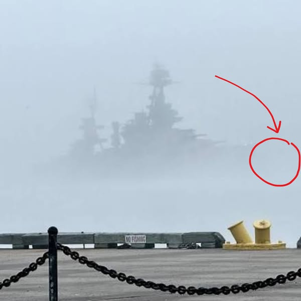

# 048 · Ready Nation USA

- **Anuncio original:** [Meta · 1792318105481637](https://www.facebook.com/ads/library/?id=1792318105481637)
- **Página anunciante:** Ready Nation USA · 1108073152395957
- **Destino observado:** [guardsurvival.com](https://guardsurvival.com/pages/advertorial-v1-guard-survival)
- **Categoría:** Hogar y preparación
- **Inicio publicado:** 2026-07-11 · 82 días de antigüedad.
- **Activo al consultar:** 2026-10-01T14:24:53.328Z.
- **Ads activos globales de esa página:** aprox. 2800 · [fuente](https://www.facebook.com/ads/library/?active_status=active&ad_type=all&country=ALL&media_type=all&search_type=page&view_all_page_id=1108073152395957).
- **Consulta geográfica:** [Estados Unidos](https://www.facebook.com/ads/library/?active_status=active&ad_type=all&country=US&is_targeted_country=false&media_type=image&search_type=page&sort_data[mode]=total_impressions&sort_data[direction]=desc&view_all_page_id=1108073152395957).
- **Longitud del texto original:** 4039 palabras; el resumen de abajo es propio.

## Apertura breve del anuncio

> The director of MIT’s fusion center — the man closest to giving the world unlimited clean

## Qué desarrolla el copy

El texto vincula supuestas muertes y desapariciones de científicos con una conversación familiar y un plan para salir de la ciudad. Usa suspenso y presunta información reservada para llegar a la necesidad de agua autónoma y vender Aqua-GS1. Se describe el argumento publicitario, sin dar por ciertas las acusaciones o conexiones conspirativas.

## Qué muestra la imagen

Silueta de un buque gris detrás de niebla, vista desde una baranda junto al agua, con círculo y flecha rojos.

## Por qué encaja en el formato nativo

Fotografía de apariencia periodística o documental, sin precio ni diseño de banner dominante; el texto largo desarrolla una historia hasta la oferta. La imagen no acredita los hechos narrados. Las marcas rojas funcionan como llamada editorial de atención y no como placa comercial.

## Cómo adaptar la idea

Conservar únicamente la estructura de una pregunta que lleva a investigar. Partir de una experiencia verificable de preparación doméstica, sin muertes insinuadas, conspiraciones ni fuentes policiales ficticias.

## Alcance de la verificación

Actividad, fecha publicada, consulta US, conteo de la página y formato revisados. No se verificó entrega continua, rentabilidad, autoría del testimonio ni los resultados que anuncia. El dominio de destino no demuestra propiedad de la página. Sin desglose de placements conservado: se verificó la consulta Meta para Estados Unidos.
