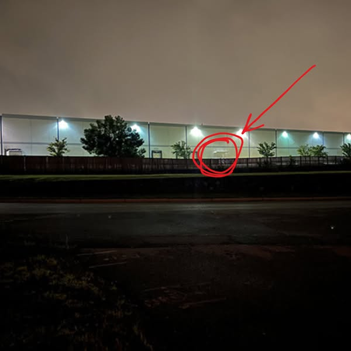

# 055 · Ready Nation USA

- **Anuncio original:** [Meta · 2033823637266006](https://www.facebook.com/ads/library/?id=2033823637266006)
- **Página anunciante:** Ready Nation USA · 1108073152395957
- **Destino observado:** [guardsurvival.com](https://guardsurvival.com/pages/advertorial-v1-guard-survival)
- **Categoría:** Hogar y preparación
- **Inicio publicado:** 2026-07-11 · 82 días de antigüedad.
- **Activo al consultar:** 2026-10-01T14:24:53.328Z.
- **Ads activos globales de esa página:** aprox. 2800 · [fuente](https://www.facebook.com/ads/library/?active_status=active&ad_type=all&country=ALL&media_type=all&search_type=page&view_all_page_id=1108073152395957).
- **Consulta geográfica:** [Estados Unidos](https://www.facebook.com/ads/library/?active_status=active&ad_type=all&country=US&is_targeted_country=false&media_type=image&search_type=page&sort_data[mode]=total_impressions&sort_data[direction]=desc&view_all_page_id=1108073152395957).
- **Longitud del texto original:** 3620 palabras; el resumen de abajo es propio.

## Apertura breve del anuncio

> My cousin works night security at one of those new AI data centers outside Columbus, and

## Qué desarrolla el copy

La historia atribuye a un guardia nocturno la observación de combustible para generadores de un centro de datos mientras los vecinos debían ahorrar energía. Contrasta infraestructura privada con vulnerabilidad doméstica, pasa de electricidad a bombeo de agua y presenta Aqua-GS1. La escena funciona como argumento del anunciante y no como noticia comprobada.

## Qué muestra la imagen

Edificio industrial iluminado de noche, visto desde la calle y señalado con un círculo y una flecha rojos.

## Por qué encaja en el formato nativo

Fotografía de apariencia periodística o documental, sin precio ni diseño de banner dominante; el texto largo desarrolla una historia hasta la oferta. La imagen no acredita los hechos narrados. Las marcas rojas funcionan como llamada editorial de atención y no como placa comercial.

## Cómo adaptar la idea

Fotografiar una instalación o equipo propio y explicar con datos comprobables cómo resuelve una dependencia cotidiana. La comparación con infraestructura ajena debe ser real, contextualizada y sin alarmismo.

## Alcance de la verificación

Actividad, fecha publicada, consulta US, conteo de la página y formato revisados. No se verificó entrega continua, rentabilidad, autoría del testimonio ni los resultados que anuncia. El dominio de destino no demuestra propiedad de la página. Sin desglose de placements conservado: se verificó la consulta Meta para Estados Unidos.
