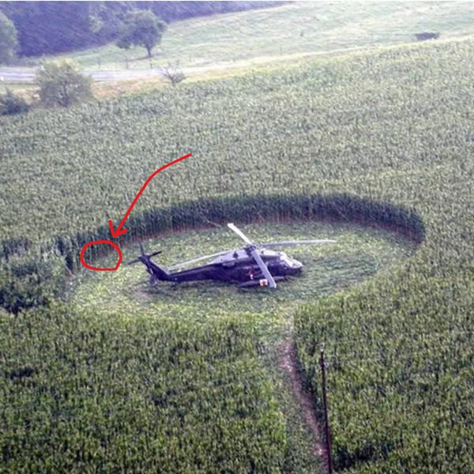

# 064 · Ready Nation USA

- **Anuncio original:** [Meta · 836556532758668](https://www.facebook.com/ads/library/?id=836556532758668)
- **Página anunciante:** Ready Nation USA · 1108073152395957
- **Destino observado:** [guardsurvival.com](https://guardsurvival.com/products/aqua-gs1)
- **Categoría:** Hogar y preparación
- **Inicio publicado:** 2026-08-01 · 61 días de antigüedad.
- **Activo al consultar:** 2026-10-01T14:24:53.328Z.
- **Ads activos globales de esa página:** aprox. 2800 · [fuente](https://www.facebook.com/ads/library/?active_status=active&ad_type=all&country=ALL&media_type=all&search_type=page&view_all_page_id=1108073152395957).
- **Consulta geográfica:** [Estados Unidos](https://www.facebook.com/ads/library/?active_status=active&ad_type=all&country=US&is_targeted_country=false&media_type=image&search_type=page&sort_data[mode]=total_impressions&sort_data[direction]=desc&view_all_page_id=1108073152395957).
- **Longitud del texto original:** 4085 palabras; el resumen de abajo es propio.

## Apertura breve del anuncio

> A helicopter landed on the property next to my farm for the third time this month,

## Qué desarrolla el copy

El anunciante narra el supuesto descubrimiento de un complejo privado junto a una granja: helicópteros, cercos y conversaciones misteriosas. Convierte esa intriga en una historia sobre preparación desigual y dependencia del agua municipal, antes de presentar el filtro por gravedad Aqua-GS1. La narración y sus insinuaciones no fueron verificadas.

## Qué muestra la imagen

Vista elevada de un helicóptero en un campo, con un círculo y una flecha rojos que señalan parte de la escena.

## Por qué encaja en el formato nativo

Fotografía de apariencia periodística o documental, sin precio ni diseño de banner dominante; el texto largo desarrolla una historia hasta la oferta. La imagen no acredita los hechos narrados. Las marcas rojas funcionan como llamada editorial de atención y no como placa comercial.

## Cómo adaptar la idea

Abrir con una observación real y fotografiada del entorno, resolver la curiosidad con hechos y explicar una necesidad doméstica concreta. No inventar vecinos, complejos secretos ni privilegios conspirativos.

## Alcance de la verificación

Actividad, fecha publicada, consulta US, conteo de la página y formato revisados. No se verificó entrega continua, rentabilidad, autoría del testimonio ni los resultados que anuncia. El dominio de destino no demuestra propiedad de la página. Sin desglose de placements conservado: se verificó la consulta Meta para Estados Unidos.
