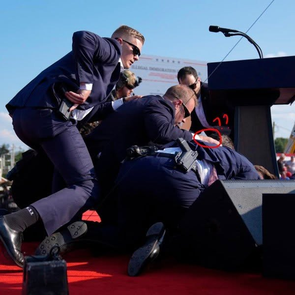

# 067 · Ready Nation USA

- **Anuncio original:** [Meta · 1026695943565578](https://www.facebook.com/ads/library/?id=1026695943565578)
- **Página anunciante:** Ready Nation USA · 1108073152395957
- **Destino observado:** [guardsurvival.com](https://guardsurvival.com/pages/radio)
- **Categoría:** Hogar y preparación
- **Inicio publicado:** 2026-08-20 · 42 días de antigüedad.
- **Activo al consultar:** 2026-10-01T14:24:53.328Z.
- **Ads activos globales de esa página:** aprox. 2800 · [fuente](https://www.facebook.com/ads/library/?active_status=active&ad_type=all&country=ALL&media_type=all&search_type=page&view_all_page_id=1108073152395957).
- **Consulta geográfica:** [Estados Unidos](https://www.facebook.com/ads/library/?active_status=active&ad_type=all&country=US&is_targeted_country=false&media_type=image&search_type=page&sort_data[mode]=total_impressions&sort_data[direction]=desc&view_all_page_id=1108073152395957).
- **Longitud del texto original:** 2130 palabras; el resumen de abajo es propio.

## Apertura breve del anuncio

> There are two Americas right now. The America that watches the news and goes to work

## Qué desarrolla el copy

El anunciante contrapone personas supuestamente informadas por reuniones reservadas con hogares que confían en la continuidad de la red. Desarrolla una brecha entre preparación e improvisación y dirige la solución hacia una radio independiente de internet y del enchufe. La autoridad de los informantes y los escenarios de crisis son afirmaciones publicitarias no verificadas.

## Qué muestra la imagen

Personas con traje rodean y protegen a otra persona sobre un escenario al aire libre, en una imagen de apariencia periodística.

## Por qué encaja en el formato nativo

Fotografía de apariencia periodística o documental, sin precio ni diseño de banner dominante; el texto largo desarrolla una historia hasta la oferta. La imagen no acredita los hechos narrados.

## Cómo adaptar la idea

Contrastar dos formas reales de preparación con una lista concreta de recursos y limitaciones. Basar la diferencia en decisiones observables, sin atribuir información clasificada a personajes.

## Alcance de la verificación

Actividad, fecha publicada, consulta US, conteo de la página y formato revisados. No se verificó entrega continua, rentabilidad, autoría del testimonio ni los resultados que anuncia. El dominio de destino no demuestra propiedad de la página. Sin desglose de placements conservado: se verificó la consulta Meta para Estados Unidos.
