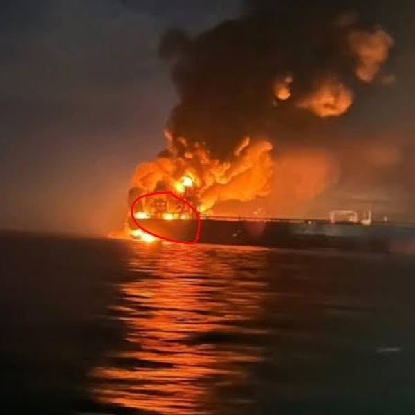

# 070 · Ready Nation USA

- **Anuncio original:** [Meta · 1731109394831252](https://www.facebook.com/ads/library/?id=1731109394831252)
- **Página anunciante:** Ready Nation USA · 1108073152395957
- **Destino observado:** [guardsurvival.com](https://guardsurvival.com/pages/radio)
- **Categoría:** Hogar y preparación
- **Inicio publicado:** 2026-08-20 · 42 días de antigüedad.
- **Activo al consultar:** 2026-10-01T14:24:53.328Z.
- **Ads activos globales de esa página:** aprox. 2800 · [fuente](https://www.facebook.com/ads/library/?active_status=active&ad_type=all&country=ALL&media_type=all&search_type=page&view_all_page_id=1108073152395957).
- **Consulta geográfica:** [Estados Unidos](https://www.facebook.com/ads/library/?active_status=active&ad_type=all&country=US&is_targeted_country=false&media_type=image&search_type=page&sort_data[mode]=total_impressions&sort_data[direction]=desc&view_all_page_id=1108073152395957).
- **Longitud del texto original:** 1626 palabras; el resumen de abajo es propio.

## Apertura breve del anuncio

> Ships are burning right now in a waterway most Americans can't find on a map. Three

## Qué desarrolla el copy

El texto afirma que ataques a buques y una crisis en una ruta marítima pueden desencadenar problemas de combustible y red eléctrica. Traslada una escena internacional al acceso cotidiano a noticias y termina vendiendo una radio de emergencia. La imagen editorial aporta intensidad, pero no demuestra las noticias, fechas o consecuencias alegadas.

## Qué muestra la imagen

Barco o instalación sobre el agua ardiendo de noche, con humo oscuro y un reflejo naranja en el mar.

## Por qué encaja en el formato nativo

Fotografía de apariencia periodística o documental, sin precio ni diseño de banner dominante; el texto largo desarrolla una historia hasta la oferta. La imagen no acredita los hechos narrados.

## Cómo adaptar la idea

Si existe un hecho noticioso pertinente, citar fuente y fecha y explicar solo consecuencias demostrables. Preferir una escena local auténtica de preparación a imágenes de guerra usadas como amenaza.

## Alcance de la verificación

Actividad, fecha publicada, consulta US, conteo de la página y formato revisados. No se verificó entrega continua, rentabilidad, autoría del testimonio ni los resultados que anuncia. El dominio de destino no demuestra propiedad de la página. Sin desglose de placements conservado: se verificó la consulta Meta para Estados Unidos.
