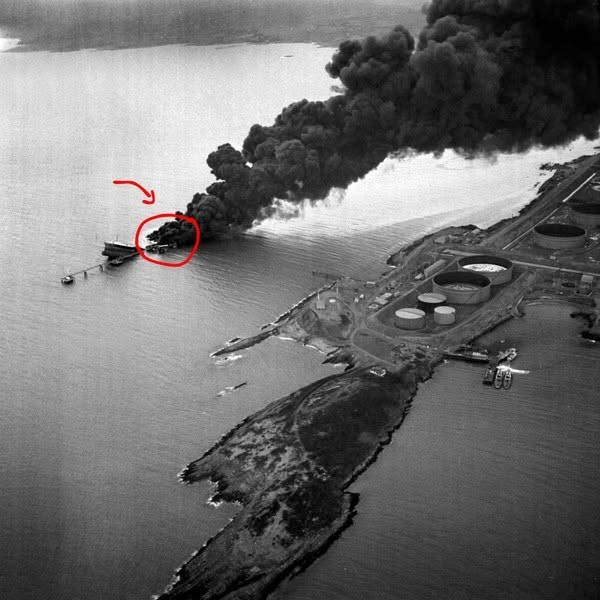

# 074 · Ready Nation USA

- **Anuncio original:** [Meta · 1987306759265854](https://www.facebook.com/ads/library/?id=1987306759265854)
- **Página anunciante:** Ready Nation USA · 1108073152395957
- **Destino observado:** [guardsurvival.com](https://guardsurvival.com/pages/advertorial-v1-guard-survival)
- **Categoría:** Hogar y preparación
- **Inicio publicado:** 2026-08-20 · 42 días de antigüedad.
- **Activo al consultar:** 2026-10-01T14:24:53.328Z.
- **Ads activos globales de esa página:** aprox. 2800 · [fuente](https://www.facebook.com/ads/library/?active_status=active&ad_type=all&country=ALL&media_type=all&search_type=page&view_all_page_id=1108073152395957).
- **Consulta geográfica:** [Estados Unidos](https://www.facebook.com/ads/library/?active_status=active&ad_type=all&country=US&is_targeted_country=false&media_type=image&search_type=page&sort_data[mode]=total_impressions&sort_data[direction]=desc&view_all_page_id=1108073152395957).
- **Longitud del texto original:** 1290 palabras; el resumen de abajo es propio.

## Apertura breve del anuncio

> Iran told you what they're going to do. They said it publicly. Two weeks ago. Then

## Qué desarrolla el copy

Atribuye a Irán amenazas y ataques contra infraestructura, y añade un supuesto plazo normativo para intensificar urgencia. Un narrador relacionado con seguridad conecta esa amenaza con agua que puede parecer normal y propone Aqua-GS1. La reseña identifica el mecanismo publicitario sin validar acusaciones, fechas, contaminación o eficacia de filtración.

## Qué muestra la imagen

Vista aérea en blanco y negro de una costa, con una embarcación o instalación que emite mucho humo y una marca roja.

## Por qué encaja en el formato nativo

Fotografía de apariencia periodística o documental, sin precio ni diseño de banner dominante; el texto largo desarrolla una historia hasta la oferta. La imagen no acredita los hechos narrados. Las marcas rojas funcionan como llamada editorial de atención y no como placa comercial.

## Cómo adaptar la idea

Enfocar un aviso público auténtico de infraestructura y las medidas recomendadas por autoridades locales. No fabricar amenazas internacionales; demostrar únicamente capacidades del producto respaldadas por pruebas.

## Alcance de la verificación

Actividad, fecha publicada, consulta US, conteo de la página y formato revisados. No se verificó entrega continua, rentabilidad, autoría del testimonio ni los resultados que anuncia. El dominio de destino no demuestra propiedad de la página. Sin desglose de placements conservado: se verificó la consulta Meta para Estados Unidos.
