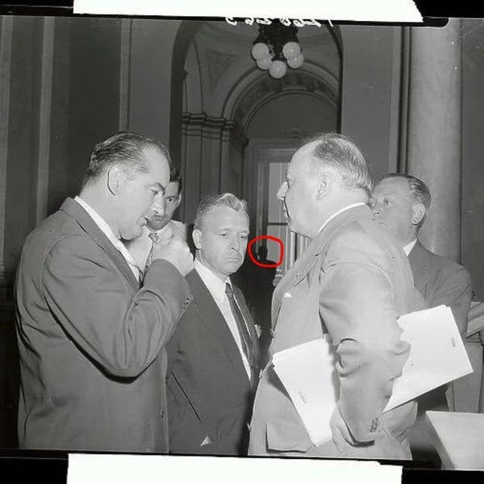

# 076 · Ready Nation USA

- **Anuncio original:** [Meta · 942676098124415](https://www.facebook.com/ads/library/?id=942676098124415)
- **Página anunciante:** Ready Nation USA · 1108073152395957
- **Destino observado:** [guardsurvival.com](https://guardsurvival.com/pages/advertorial-v1-guard-survival)
- **Categoría:** Hogar y preparación
- **Inicio publicado:** 2026-08-20 · 42 días de antigüedad.
- **Activo al consultar:** 2026-10-01T14:24:53.328Z.
- **Ads activos globales de esa página:** aprox. 2800 · [fuente](https://www.facebook.com/ads/library/?active_status=active&ad_type=all&country=ALL&media_type=all&search_type=page&view_all_page_id=1108073152395957).
- **Consulta geográfica:** [Estados Unidos](https://www.facebook.com/ads/library/?active_status=active&ad_type=all&country=US&is_targeted_country=false&media_type=image&search_type=page&sort_data[mode]=total_impressions&sort_data[direction]=desc&view_all_page_id=1108073152395957).
- **Longitud del texto original:** 1792 palabras; el resumen de abajo es propio.

## Apertura breve del anuncio

> I'm an ER nurse. In the last year I've treated nine children in this

## Qué desarrolla el copy

Una narradora que dice trabajar en urgencias describe casos pediátricos y conecta el riesgo del agua con un filtro portátil. El relato, las credenciales y los acontecimientos que afirma el anuncio no están verificados.

## Qué muestra la imagen

Fotografía histórica en blanco y negro de hombres conversando, con una pequeña anotación roja.

## Por qué encaja en el formato nativo

Imagen de apariencia documental sin precio, packaging destacado ni CTA superpuesto; el argumento comercial se desarrolla en el copy.

## Cómo adaptar la idea

Partir de una experiencia documentada sobre uso de agua en viajes y explicar los límites reales de filtración. Evitar atribuir recomendaciones a sanitarios inexistentes.

## Alcance de la verificación

Actividad, fecha publicada, consulta US, conteo de la página y formato revisados. No se verificó entrega continua, rentabilidad, autoría del testimonio ni los resultados que anuncia. El dominio de destino no demuestra propiedad de la página. Sin desglose de placements conservado: se verificó la consulta Meta para Estados Unidos.
