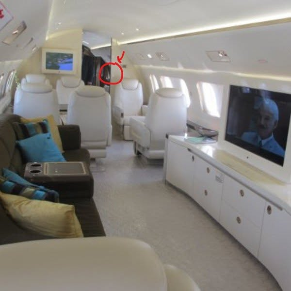

# 078 · Ready Nation USA

- **Anuncio original:** [Meta · 1717346452667094](https://www.facebook.com/ads/library/?id=1717346452667094)
- **Página anunciante:** Ready Nation USA · 1108073152395957
- **Destino observado:** [guardsurvival.com](https://guardsurvival.com/pages/radio)
- **Categoría:** Hogar y preparación
- **Inicio publicado:** 2026-08-20 · 42 días de antigüedad.
- **Activo al consultar:** 2026-10-01T14:24:53.328Z.
- **Ads activos globales de esa página:** aprox. 2800 · [fuente](https://www.facebook.com/ads/library/?active_status=active&ad_type=all&country=ALL&media_type=all&search_type=page&view_all_page_id=1108073152395957).
- **Consulta geográfica:** [Estados Unidos](https://www.facebook.com/ads/library/?active_status=active&ad_type=all&country=US&is_targeted_country=false&media_type=image&search_type=page&sort_data[mode]=total_impressions&sort_data[direction]=desc&view_all_page_id=1108073152395957).
- **Longitud del texto original:** 1775 palabras; el resumen de abajo es propio.

## Apertura breve del anuncio

> Something shifted three months ago in the flight requests I get. I fly private

## Qué desarrolla el copy

El relato de un supuesto piloto usa cambios en los viajes de sus pasajeros como señal de alarma y acaba proponiendo una radio. El relato, las credenciales y los acontecimientos que afirma el anuncio no están verificados.

## Qué muestra la imagen

Foto casual del interior de un avión privado; una figura aparece señalada al fondo.

## Por qué encaja en el formato nativo

Imagen de apariencia documental sin precio, packaging destacado ni CTA superpuesto; el argumento comercial se desarrolla en el copy.

## Cómo adaptar la idea

Mostrar un cambio observable en un contexto cotidiano y llevarlo a una necesidad práctica, con personas y hechos verificables.

## Alcance de la verificación

Actividad, fecha publicada, consulta US, conteo de la página y formato revisados. No se verificó entrega continua, rentabilidad, autoría del testimonio ni los resultados que anuncia. El dominio de destino no demuestra propiedad de la página. Sin desglose de placements conservado: se verificó la consulta Meta para Estados Unidos.
