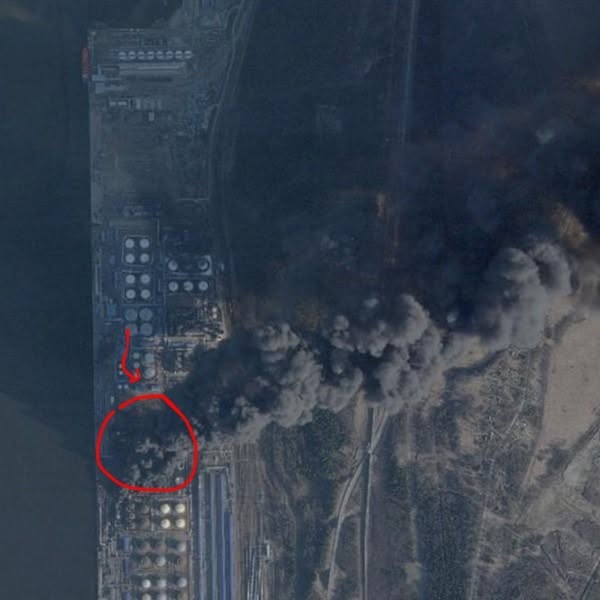

# 080 · Ready Nation USA

- **Anuncio original:** [Meta · 2638363346614311](https://www.facebook.com/ads/library/?id=2638363346614311)
- **Página anunciante:** Ready Nation USA · 1108073152395957
- **Destino observado:** [guardsurvival.com](https://guardsurvival.com/pages/advertorial-v1-guard-survival)
- **Categoría:** Hogar y preparación
- **Inicio publicado:** 2026-08-20 · 42 días de antigüedad.
- **Activo al consultar:** 2026-10-01T14:24:53.328Z.
- **Ads activos globales de esa página:** aprox. 2800 · [fuente](https://www.facebook.com/ads/library/?active_status=active&ad_type=all&country=ALL&media_type=all&search_type=page&view_all_page_id=1108073152395957).
- **Consulta geográfica:** [Estados Unidos](https://www.facebook.com/ads/library/?active_status=active&ad_type=all&country=US&is_targeted_country=false&media_type=image&search_type=page&sort_data[mode]=total_impressions&sort_data[direction]=desc&view_all_page_id=1108073152395957).
- **Longitud del texto original:** 1774 palabras; el resumen de abajo es propio.

## Apertura breve del anuncio

> Before the bombs fell on Iran, a message reached the President's desk warning him

## Qué desarrolla el copy

El texto invoca un presunto mensaje gubernamental y un familiar con información reservada para vender filtración de agua. El relato, las credenciales y los acontecimientos que afirma el anuncio no están verificados.

## Qué muestra la imagen

Fotografía de un edificio alto con humo y marcas rojas, de apariencia periodística.

## Por qué encaja en el formato nativo

Imagen de apariencia documental sin precio, packaging destacado ni CTA superpuesto; el argumento comercial se desarrolla en el copy.

## Cómo adaptar la idea

Tomar únicamente la secuencia escena, problema y solución; reemplazar la amenaza política no verificada por una situación real de camping o corte de suministro.

## Alcance de la verificación

Actividad, fecha publicada, consulta US, conteo de la página y formato revisados. No se verificó entrega continua, rentabilidad, autoría del testimonio ni los resultados que anuncia. El dominio de destino no demuestra propiedad de la página. Sin desglose de placements conservado: se verificó la consulta Meta para Estados Unidos.
