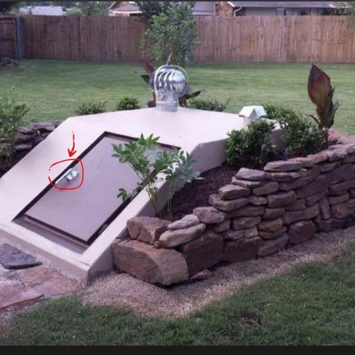

# 084 · Ready Nation USA

- **Anuncio original:** [Meta · 1044341488363404](https://www.facebook.com/ads/library/?id=1044341488363404)
- **Página anunciante:** Ready Nation USA · 1108073152395957
- **Destino observado:** [guardsurvival.com](https://guardsurvival.com/pages/advertorial-v1-guard-survival)
- **Categoría:** Hogar y preparación
- **Inicio publicado:** 2026-08-26 · 36 días de antigüedad.
- **Activo al consultar:** 2026-10-01T14:24:53.328Z.
- **Ads activos globales de esa página:** aprox. 2800 · [fuente](https://www.facebook.com/ads/library/?active_status=active&ad_type=all&country=ALL&media_type=all&search_type=page&view_all_page_id=1108073152395957).
- **Consulta geográfica:** [Estados Unidos](https://www.facebook.com/ads/library/?active_status=active&ad_type=all&country=US&is_targeted_country=false&media_type=image&search_type=page&sort_data[mode]=total_impressions&sort_data[direction]=desc&view_all_page_id=1108073152395957).
- **Longitud del texto original:** 1698 palabras; el resumen de abajo es propio.

## Apertura breve del anuncio

> They rehearsed it first. On another country. In 2015. Shut off the power for 230,000 people

## Qué desarrolla el copy

Un narrador presentado como conocedor de ciberseguridad usa ataques históricos a redes eléctricas como introducción a una supuesta amenaza futura. Conecta la dependencia eléctrica del suministro de agua con una fecha que agrega urgencia y ofrece Aqua-GS1. Esta reseña registra esa secuencia persuasiva, sin confirmar predicciones, plazos ni capacidades del producto.

## Qué muestra la imagen

Jardín con una entrada descendente o escotilla junto a un muro de piedra; una flecha roja señala el acceso.

## Por qué encaja en el formato nativo

Escena u objeto del entorno cotidiano, presentado como observación personal y acompañado de un relato extenso. No usa un banner de oferta; la autenticidad de la historia no está comprobada. Las marcas rojas funcionan como llamada editorial de atención y no como placa comercial.

## Cómo adaptar la idea

Explicar una dependencia técnica real con fuentes claras y una demostración del equipo. Diferenciar hechos históricos de hipótesis, y eliminar plazos artificiales o amenazas sin verificar.

## Alcance de la verificación

Actividad, fecha publicada, consulta US, conteo de la página y formato revisados. No se verificó entrega continua, rentabilidad, autoría del testimonio ni los resultados que anuncia. El dominio de destino no demuestra propiedad de la página. Sin desglose de placements conservado: se verificó la consulta Meta para Estados Unidos.
