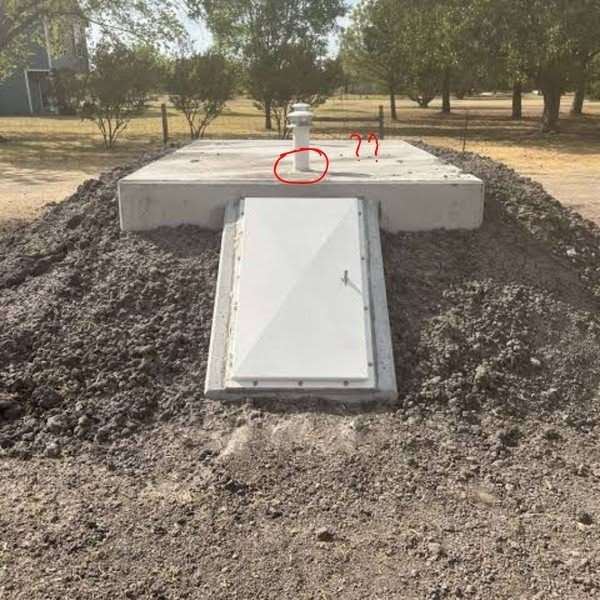

# 086 · Ready Nation USA

- **Anuncio original:** [Meta · 1929056644717574](https://www.facebook.com/ads/library/?id=1929056644717574)
- **Página anunciante:** Ready Nation USA · 1108073152395957
- **Destino observado:** [guardsurvival.com](https://guardsurvival.com/pages/advertorial-v1-guard-survival)
- **Categoría:** Hogar y preparación
- **Inicio publicado:** 2026-08-26 · 36 días de antigüedad.
- **Activo al consultar:** 2026-10-01T14:24:53.328Z.
- **Ads activos globales de esa página:** aprox. 2800 · [fuente](https://www.facebook.com/ads/library/?active_status=active&ad_type=all&country=ALL&media_type=all&search_type=page&view_all_page_id=1108073152395957).
- **Consulta geográfica:** [Estados Unidos](https://www.facebook.com/ads/library/?active_status=active&ad_type=all&country=US&is_targeted_country=false&media_type=image&search_type=page&sort_data[mode]=total_impressions&sort_data[direction]=desc&view_all_page_id=1108073152395957).
- **Longitud del texto original:** 1482 palabras; el resumen de abajo es propio.

## Apertura breve del anuncio

> Half the transformers on the American grid are older than the people operating them. Replacements take

## Qué desarrolla el copy

El anunciante combina supuestos datos sobre transformadores envejecidos y demoras de reposición con afirmaciones sobre amenazas extranjeras. Usa esa acumulación para recorrer la dependencia del hogar respecto de la red, especialmente el agua, antes de presentar Aqua-GS1. No se comprobaron estadísticas, atribuciones de inteligencia ni previsiones.

## Qué muestra la imagen

Escotilla de hormigón y tapa metálica en un terreno exterior, con pequeños círculos rojos sobre la parte superior.

## Por qué encaja en el formato nativo

Escena u objeto del entorno cotidiano, presentado como observación personal y acompañado de un relato extenso. No usa un banner de oferta; la autenticidad de la historia no está comprobada. Las marcas rojas funcionan como llamada editorial de atención y no como placa comercial.

## Cómo adaptar la idea

Explicar con fuentes técnicas una dependencia cotidiana y lo que el cliente puede preparar de forma proporcionada. Mantener separadas las cifras verificadas de escenarios hipotéticos o de inteligencia.

## Alcance de la verificación

Actividad, fecha publicada, consulta US, conteo de la página y formato revisados. No se verificó entrega continua, rentabilidad, autoría del testimonio ni los resultados que anuncia. El dominio de destino no demuestra propiedad de la página. Sin desglose de placements conservado: se verificó la consulta Meta para Estados Unidos.
